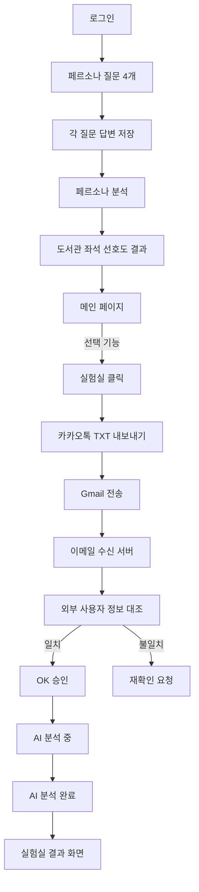
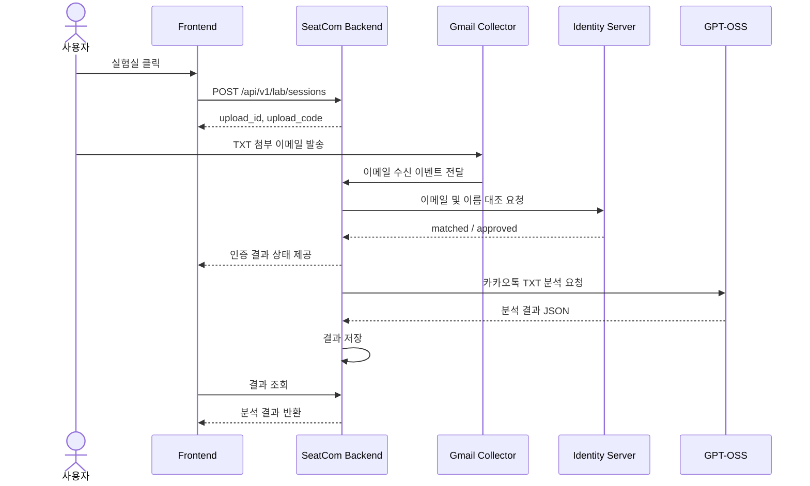

# [API Specification] SeatCom 페르소나 기반 도서관 추천 및 카카오톡 AI 실험실

> **Version:** 2.1  
> **Framework:** FastAPI  
> **API Format:** REST API / JSON  
> **Status:** Frontend–Backend API Contract  
> **Last Updated:** 2026-11-15

---

# 1. Overview

SeatCom은 사용자의 도서관 이용 성향을 분석하여 적합한 좌석이나 공간을 추천하는 서비스입니다.

서비스는 크게 두 가지 기능으로 구성됩니다.

## 1.1 페르소나 분석 (Main Feature)

사용자는 로그인 이후 **4개의 간단한 질문**에 답변하여 자신의 좌석 선호도를 설정할 수 있습니다.

- 로그인 후 4개의 질문 제공
- 각 질문의 선택지를 클릭하여 답변
- 각 답변을 백엔드 API로 저장
- 모든 질문에 응답하면 페르소나 분석 실행
- 사용자 선호 조건에 맞는 좌석 및 공간 추천
- 분석 결과 저장 및 재조회 지원

카카오톡 분석을 이용하지 않아도 기본 서비스를 이용할 수 있습니다.

## 1.2 실험실 — 카카오톡 AI 분석 (Experimental Feature)

기본 페르소나 분석을 완료한 사용자가 선택적으로 이용하는 추가 기능입니다.

사용자는 카카오톡 대화 내용을 TXT로 내보내 이메일에 첨부하여 전송합니다.

서버는 이메일 수신과 사용자 정보 대조를 완료한 후 AI 분석을 실행합니다.

- 카카오톡 대화 내보내기 튜토리얼
- Gmail을 통한 TXT 파일 수신
- 별도 서버를 통한 사용자 이름 및 이메일 대조
- 사용자 정보 일치 여부 확인
- 승인 완료 시 AI 분석 시작
- GPT-OSS 기반 대화 분석
- 분석 진행 상태 확인
- 분석 결과 조회

**기본 페르소나 분석과 카카오톡 AI 분석 결과는 별도로 저장합니다.**

---

# 2. Overall User Flow



## 핵심 정책

1. 기본 온보딩은 페르소나 4문항으로 구성합니다.
2. 사용자는 질문에 답변한 후 기본 서비스를 이용할 수 있습니다.
3. 카카오톡 분석은 선택적으로 진행합니다.
4. 카카오톡 데이터를 제공하지 않아도 기본 기능은 제한되지 않습니다.
5. 설문 결과와 AI 분석 결과는 별도로 보관합니다.
6. 사용자는 본인의 분석 상태 및 결과만 조회할 수 있습니다.

---

# 3. Common API Rules

## 3.1 API 기본 설정

| 항목 | 내용 |
|---|---|
| Base URL | `https://api.example.com` |
| API Version | `v1` |
| User API Prefix | `/api/v1` |
| Internal API Prefix | `/internal/v1` |
| Content-Type | `application/json` |
| Authentication | Bearer Token |
| Response Format | JSON |
| Framework | FastAPI |

> Base URL 및 인증 방식은 배포 환경에 따라 확정합니다.

## 3.2 사용자 API 인증

모든 사용자용 API는 다음 인증 헤더를 사용합니다.

```http
Authorization: Bearer <ACCESS_TOKEN>
Content-Type: application/json
```

사용자 ID는 인증된 세션에서 조회합니다.

프론트엔드가 임의의 사용자 ID를 전달하여 타인의 정보를 조회하거나 수정할 수 없도록 합니다.

## 3.3 서버 간 인증

서버 간 API는 별도의 인증 수단을 사용합니다.

```http
Authorization: Bearer <SERVICE_TOKEN>
Content-Type: application/json
```

내부 API는 일반 사용자에게 공개하지 않습니다.

## 3.4 공통 HTTP Status

| HTTP Status | 의미 |
|---|---|
| 200 | 요청 성공 |
| 201 | 리소스 생성 완료 |
| 202 | 비동기 작업 접수 |
| 400 | 잘못된 요청 |
| 401 | 인증 실패 |
| 403 | 접근 권한 없음 |
| 404 | 데이터 없음 |
| 409 | 중복 또는 상태 충돌 |
| 410 | 세션 만료 |
| 422 | 입력값 검증 실패 |
| 500 | 서버 오류 |
| 502 | 외부 서버 연동 실패 |
| 503 | AI 서비스 이용 불가 |

---

# Part A. 페르소나 분석 API

# 4. 페르소나 질문 정의

총 4개의 필수 질문을 제공합니다.

## 4.1 질문 및 선택지

| # | Question ID | 질문 | 선택지 |
|---|---|---|---|
| 1 | `outlet` | 노트북을 주로 사용하시나요? (또는 주로 콘센트가 필요하신가요?) | 네 / 아니오 |
| 2 | `hvac_proximity` | 에어컨과 가까운 것을 선호하시나요? | 네 / 아니오 / 상관없음 |
| 3 | `noise_sensitivity` | 소음에 민감하신가요? | 많이 / 조금 / 괜찮아요 |
| 4 | `partition` | 칸막이가 있는 자리를 선호하시나요? | 네 / 아니오 / 상관없음 |

## 4.2 답변 코드

### Q1 — 콘센트 필요 여부

| 표시 | Value |
|---|---|
| 네 | `required` |
| 아니오 | `not_required` |

### Q2 — 에어컨 거리 선호

| 표시 | Value |
|---|---|
| 네 | `near` |
| 아니오 | `not_near` |
| 상관없음 | `no_preference` |

### Q3 — 소음 민감도

| 표시 | Value |
|---|---|
| 많이 | `high` |
| 조금 | `low` |
| 괜찮아요 | `none` |

### Q4 — 칸막이 선호

| 표시 | Value |
|---|---|
| 네 | `yes` |
| 아니오 | `no` |
| 상관없음 | `no_preference` |

> Q1은 노트북 사용과 콘센트 필요 여부를 하나의 질문으로 간소화한 것입니다. 실제로 두 조건은 다를 수 있으므로 분석 결과에서는 `outlet`을 콘센트 필요 여부의 근사값으로 사용합니다.

---

# 5. Persona API Endpoints

## API 1. 페르소나 질문 목록 조회

### GET `/api/v1/persona/questions`

사용자에게 표시할 4개의 질문과 선택지를 반환합니다.

### Request JSON

GET 요청이므로 실제 Request Body는 없습니다.

```json
{
  "method": "GET",
  "path": "/api/v1/persona/questions",
  "headers": {
    "Authorization": "Bearer <ACCESS_TOKEN>"
  },
  "body": null
}
```

### Response — 200 OK

```json
{
  "version": "2.1",
  "required_count": 4,
  "questions": [
    {
      "id": "outlet",
      "order": 1,
      "question": "노트북을 주로 사용하시나요? (또는 주로 콘센트가 필요하신가요?)",
      "options": [
        {
          "label": "네",
          "value": "required"
        },
        {
          "label": "아니오",
          "value": "not_required"
        }
      ]
    },
    {
      "id": "hvac_proximity",
      "order": 2,
      "question": "에어컨과 가까운 것을 선호하시나요?",
      "options": [
        {
          "label": "네",
          "value": "near"
        },
        {
          "label": "아니오",
          "value": "not_near"
        },
        {
          "label": "상관없음",
          "value": "no_preference"
        }
      ]
    },
    {
      "id": "noise_sensitivity",
      "order": 3,
      "question": "소음에 민감하신가요?",
      "options": [
        {
          "label": "많이",
          "value": "high"
        },
        {
          "label": "조금",
          "value": "low"
        },
        {
          "label": "괜찮아요",
          "value": "none"
        }
      ]
    },
    {
      "id": "partition",
      "order": 4,
      "question": "칸막이가 있는 자리를 선호하시나요?",
      "options": [
        {
          "label": "네",
          "value": "yes"
        },
        {
          "label": "아니오",
          "value": "no"
        },
        {
          "label": "상관없음",
          "value": "no_preference"
        }
      ]
    }
  ]
}
```

### Frontend Requirements

- API에서 질문 목록을 조회합니다.
- 질문 순서는 `order`를 기준으로 정렬합니다.
- 선택지는 버튼 또는 카드 형태로 표시합니다.
- 총 4개 질문의 진행률을 표시합니다.
- 사용자가 답변을 선택하면 개별 답변 저장 API를 호출합니다.

---

## API 2. 개별 질문 답변 저장

### PUT `/api/v1/persona/answers/{question_id}`

사용자가 각 질문에 답변할 때마다 해당 답변을 저장합니다.

동일 질문에 다시 답변하면 기존 답변을 덮어씁니다.

### Q1. 노트북을 주로 사용하시나요?

**Endpoint**

```http
PUT /api/v1/persona/answers/outlet
```

**Request JSON**

```json
{
  "answer": "required"
}
```

허용 값:

- `required`
- `not_required`

### Q2. 에어컨과 가까운 것을 선호하시나요?

**Endpoint**

```http
PUT /api/v1/persona/answers/hvac_proximity
```

**Request JSON**

```json
{
  "answer": "near"
}
```

허용 값:

- `near`
- `not_near`
- `no_preference`

### Q3. 소음에 민감하신가요?

**Endpoint**

```http
PUT /api/v1/persona/answers/noise_sensitivity
```

**Request JSON**

```json
{
  "answer": "high"
}
```

허용 값:

- `high`
- `low`
- `none`

### Q4. 칸막이가 있는 자리를 선호하시나요?

**Endpoint**

```http
PUT /api/v1/persona/answers/partition
```

**Request JSON**

```json
{
  "answer": "yes"
}
```

허용 값:

- `yes`
- `no`
- `no_preference`

### Response — 200 OK

모든 질문에서 동일한 응답 구조를 사용합니다.

```json
{
  "question_id": "outlet",
  "answer": "required",
  "saved": true,
  "answered_count": 1,
  "required_count": 4,
  "can_analyze": false,
  "updated_at": "2026-11-15T02:00:00+09:00"
}
```

### Response Fields

| Field | Type | 설명 |
|---|---|---|
| `question_id` | string | 저장된 질문 ID |
| `answer` | string | 저장된 답변 |
| `saved` | boolean | 저장 성공 여부 |
| `answered_count` | integer | 현재 답변 완료 개수 |
| `required_count` | integer | 전체 질문 개수 |
| `can_analyze` | boolean | 분석 가능 여부 |
| `updated_at` | string | 마지막 저장 시간 |

### Error — 422

```json
{
  "error": {
    "code": "INVALID_ANSWER",
    "message": "허용되지 않은 답변입니다.",
    "question_id": "partition",
    "allowed_values": [
      "yes",
      "no",
      "no_preference"
    ]
  }
}
```

### Frontend Requirements

1. 사용자가 선택지를 클릭합니다.
2. 선택한 질문 ID와 답변 값을 전송합니다.
3. `saved=true` 응답을 확인합니다.
4. 저장 완료 시 다음 질문으로 이동합니다.
5. 이전 질문으로 돌아가 답변을 수정할 수 있습니다.
6. 4개 질문이 모두 완료되면 분석 버튼을 활성화합니다.

---

## API 3. 저장된 답변 조회

### GET `/api/v1/persona/answers`

이전에 저장한 답변을 조회합니다.

새로고침이나 재로그인 이후 진행 상태를 복원하는 데 사용합니다.

### Request JSON

```json
{
  "method": "GET",
  "path": "/api/v1/persona/answers",
  "headers": {
    "Authorization": "Bearer <ACCESS_TOKEN>"
  },
  "body": null
}
```

### Response — 200 OK

```json
{
  "answers": {
    "outlet": "required",
    "hvac_proximity": "near",
    "noise_sensitivity": "high",
    "partition": "yes"
  },
  "answered_count": 4,
  "required_count": 4,
  "can_analyze": true
}
```

### 미완료 응답 예시

```json
{
  "answers": {
    "outlet": "required",
    "hvac_proximity": "near",
    "noise_sensitivity": null,
    "partition": null
  },
  "answered_count": 2,
  "required_count": 4,
  "can_analyze": false
}
```

### Frontend Requirements

- 기존 답변이 있다면 선택 상태를 복원합니다.
- 미응답 문항은 선택되지 않은 상태로 표시합니다.
- `can_analyze=true`일 때 분석 버튼을 활성화합니다.

---

## API 4. 페르소나 분석 요청

### POST `/api/v1/persona/analyze`

4개 질문에 모두 답변한 후 분석을 실행합니다.

백엔드는 저장된 4개 답변을 기준으로 좌석 선호도 결과를 생성합니다.

### Request JSON

```json
{
  "analysis_type": "library_preference"
}
```

### Response — 200 OK

```json
{
  "analysis_id": "prs_d3a91c02",
  "analysis_method": "persona",
  "status": "completed",
  "seat_preferences": {
    "outlet": "required",
    "hvac_proximity": "near",
    "noise_sensitivity": "high",
    "partition": "yes"
  },
  "source": "self_report",
  "completed_at": "2026-11-15T02:00:00+09:00"
}
```

### Error — 422

모든 질문에 답변하지 않은 경우입니다.

```json
{
  "error": {
    "code": "INCOMPLETE_ANSWERS",
    "message": "모든 질문에 답변해야 합니다.",
    "missing_questions": [
      "noise_sensitivity",
      "partition"
    ]
  }
}
```

### 분석 정책

- 4개 질문 모두 응답해야 분석을 실행합니다.
- 분석 결과는 사용자별로 저장합니다.
- 카카오톡 AI 분석 결과와 별도로 관리합니다.
- 응답은 사용자가 직접 선택한 선호 조건을 그대로 보존합니다.
- 실제 좌석 추천은 좌석 위치 및 시설 정보와 별도로 매칭합니다.

---

## API 5. 페르소나 분석 결과 조회

### GET `/api/v1/persona/result`

현재 사용자의 마지막 페르소나 분석 결과를 조회합니다.

### Request JSON

```json
{
  "method": "GET",
  "path": "/api/v1/persona/result",
  "headers": {
    "Authorization": "Bearer <ACCESS_TOKEN>"
  },
  "body": null
}
```

### Response — 200 OK

```json
{
  "analysis_id": "prs_d3a91c02",
  "analysis_method": "persona",
  "status": "completed",
  "seat_preferences": {
    "outlet": "required",
    "hvac_proximity": "near",
    "noise_sensitivity": "high",
    "partition": "yes"
  },
  "source": "self_report",
  "completed_at": "2026-11-15T02:00:00+09:00"
}
```

### Error — 404

```json
{
  "error": {
    "code": "PERSONA_NOT_FOUND",
    "message": "완료된 페르소나 분석 결과가 없습니다."
  }
}
```

### Frontend Requirements

- 분석 결과를 사용자에게 표시합니다.
- 주요 좌석 선호 조건을 요약합니다.
- 결과 화면에서 메인 페이지로 이동할 수 있도록 합니다.
- 이후 실험실 기능을 선택적으로 이용할 수 있도록 합니다.

---

# Part B. 실험실 — 카카오톡 AI 분석

# 6. Laboratory Overview

실험실은 사용자가 카카오톡 대화 내역을 활용하여 AI 기반 성향 분석을 체험하는 선택 기능입니다.

기존 분석 코드의 다음 메서드를 활용합니다.

```python
PersonalityAnalysis.analyze_by_GPT_OSS_API(
    source,
    name
)
```

Gmail TXT 수집에는 기존 `TxtFromGmail` 기반 수집 기능을 사용합니다.

> 기존 메서드는 FastAPI 서비스 계층에서 import하여 사용합니다. Gmail 수신 이벤트의 사용자별 세션 연결 및 외부 인증은 별도 구현이 필요합니다.

## 6.1 Laboratory User Flow



---

# 7. Laboratory API Endpoints

## API 6. 실험실 분석 세션 생성

### POST `/api/v1/lab/sessions`

사용자가 실험실 기능을 시작하면 분석 세션을 생성합니다.

사용자별 고유 업로드 코드를 발급합니다.

### Request JSON

```json
{
  "target_name": "홍길동",
  "consent": true
}
```

### Request Fields

| Field | Type | Required | 설명 |
|---|---|---|---|
| `target_name` | string | Yes | 분석 대상 카카오톡 표시 이름 |
| `consent` | boolean | Yes | 데이터 수집 및 분석 동의 |

### Response — 201 Created

```json
{
  "upload_id": "upl_78f0ab2c",
  "upload_code": "SC-78F0AB2C",
  "recipient_email": "taywook74@gmail.com",
  "mail_subject": "SeatCom SC-78F0AB2C",
  "target_name": "홍길동",
  "status": "waiting_email",
  "expires_at": "2026-11-15T03:00:00+09:00",
  "poll_interval_seconds": 5
}
```

### Frontend Requirements

- 사용자가 카카오톡 TXT 파일을 내보내도록 안내합니다.
- 발급된 수신 이메일 주소를 표시합니다.
- 지정된 메일 제목을 표시합니다.
- 이메일 주소 복사 버튼을 제공합니다.
- 메일 제목 복사 버튼을 제공합니다.
- TXT 파일 첨부 방법을 안내합니다.
- 사용자가 이메일을 보낸 후 수신 확인 화면으로 이동합니다.

### Error — 400

```json
{
  "error": {
    "code": "CONSENT_REQUIRED",
    "message": "카카오톡 분석을 진행하려면 데이터 처리에 동의해야 합니다."
  }
}
```

---

## API 7. Gmail 이메일 수신 이벤트 전달

### POST `/internal/v1/lab/email-received`

**호출 주체: Gmail 수신 서버 → SeatCom Backend**

Gmail 수집기가 카카오톡 TXT 파일을 수신한 경우 메인 백엔드에 수신 사실을 전달합니다.

이메일 수신 자체는 사용자 인증 완료를 의미하지 않습니다.

### Request JSON

```json
{
  "event_id": "evt_12345",
  "upload_id": "upl_78f0ab2c",
  "upload_code": "SC-78F0AB2C",
  "sender": {
    "name": "홍길동",
    "email": "user@example.com"
  },
  "email": {
    "subject": "SeatCom SC-78F0AB2C",
    "message_id": "msg_12345",
    "received_at": "2026-11-15T02:05:00+09:00"
  },
  "attachment": {
    "file_id": "file_12345",
    "filename": "KakaoTalk.txt",
    "file_type": "txt",
    "validation_status": "valid"
  }
}
```

### Response — 200 OK

```json
{
  "success": true,
  "upload_id": "upl_78f0ab2c",
  "email_received": true,
  "identity_verified": false,
  "status": "verifying_identity",
  "message": "이메일 수신이 확인되었습니다. 사용자 정보를 대조합니다."
}
```

### Processing Rules

1. 이메일의 제목 코드를 확인합니다.
2. 업로드 세션과 연결합니다.
3. TXT 파일 형식 및 크기를 검증합니다.
4. 이메일 발신자 정보를 확인합니다.
5. 등록 사용자 대조 서버에 검증을 요청합니다.
6. 동일 이벤트가 중복 전달되어도 중복 분석하지 않습니다.

> 실제 Gmail 수집기는 메일 제목, 메시지 ID 및 첨부파일 ID를 이용해 업로드 세션과 연결해야 합니다. 발신자 이름만으로 사용자를 인증하지 않습니다.

---

## API 8. 외부 사용자 정보 대조

### POST `/internal/v1/identity/verify`

**호출 주체: SeatCom Backend → 별도 사용자 등록 서버**

이메일을 전송한 사용자와 로그인한 등록 사용자의 정보가 일치하는지 요청합니다.

### Request JSON

```json
{
  "verification_request_id": "ver_6b8a201f",
  "user_id": "usr_91a2b3c4",
  "upload_id": "upl_78f0ab2c",
  "sender_email": "user@example.com",
  "target_name": "홍길동"
}
```

### Request Fields

| Field | Type | 설명 |
|---|---|---|
| `verification_request_id` | string | 검증 요청 고유 ID |
| `user_id` | string | 로그인 사용자 ID |
| `upload_id` | string | 업로드 세션 ID |
| `sender_email` | string | 이메일 발신 주소 |
| `target_name` | string | 분석 대상 이름 |

### Response — 200 OK (일치)

```json
{
  "verification_request_id": "ver_6b8a201f",
  "user_id": "usr_91a2b3c4",
  "matched": true,
  "verification": "approved",
  "checks": {
    "email_match": true,
    "name_match": true
  },
  "verified_at": "2026-11-15T02:05:05+09:00"
}
```

### Response — 200 OK (불일치)

```json
{
  "verification_request_id": "ver_6b8a201f",
  "user_id": "usr_91a2b3c4",
  "matched": false,
  "verification": "rejected",
  "checks": {
    "email_match": false,
    "name_match": true
  },
  "reason_code": "EMAIL_MISMATCH",
  "verified_at": "2026-11-15T02:05:05+09:00"
}
```

### Verification Rules

- 등록된 사용자 ID를 기준으로 검증합니다.
- 등록된 이메일과 발신 이메일을 대조합니다.
- 등록된 이름과 전달된 이름을 대조합니다.
- 두 항목이 일치해야 `matched=true`를 반환합니다.
- 실제 신원 확인에는 인증된 로그인 세션 및 이메일 발신 검증 등 추가 보호 조치를 적용합니다.
- 검증에 실패한 파일은 AI 분석을 진행하지 않습니다.

> 이름과 이메일의 단순 일치는 실제 계정 소유자임을 완전히 증명하지 않습니다. `approved`는 등록 정보 대조 통과를 의미하며, 서비스에서는 별도 인증 조건도 충족해야 분석을 승인합니다.

---

## API 9. 사용자 대조 승인 및 AI 분석 시작

### POST `/internal/v1/lab/analysis-approved`

**호출 주체: SeatCom Backend → AI 분석 서비스**

사용자 정보 대조가 승인되면 분석 작업을 시작합니다.

### Request JSON

```json
{
  "upload_id": "upl_78f0ab2c",
  "user_id": "usr_91a2b3c4",
  "identity_verification": {
    "matched": true,
    "verification": "approved",
    "verification_request_id": "ver_6b8a201f"
  },
  "analysis": {
    "analysis_type": "kakao_chat",
    "target_name": "홍길동",
    "file_id": "file_12345"
  }
}
```

### Response — 202 Accepted

```json
{
  "success": true,
  "upload_id": "upl_78f0ab2c",
  "analysis_id": "lab_5b32e1c9",
  "status": "analyzing",
  "message": "사용자 확인이 완료되었습니다. AI 분석을 시작합니다."
}
```

### Backend Processing

```python
result = PersonalityAnalysis.analyze_by_GPT_OSS_API(
    source=txt_path,
    name=target_name
)
```

실제 호출 시에는 업로드 세션 및 검증된 파일 경로를 사용합니다.

AI 분석 작업은 별도의 백그라운드 작업 처리 시스템에서 실행하도록 구성합니다.

분석이 완료되면 결과를 DB에 저장하고 상태를 `completed`로 변경합니다.

---

## API 10. 실험실 진행 상태 조회

### GET `/api/v1/lab/sessions/{upload_id}/status`

**호출 주체: Frontend → SeatCom Backend**

프론트엔드가 Gmail 수신 여부, 사용자 인증 결과 및 AI 분석 진행 상태를 조회합니다.

### Request JSON

```json
{
  "method": "GET",
  "path": "/api/v1/lab/sessions/upl_78f0ab2c/status",
  "headers": {
    "Authorization": "Bearer <ACCESS_TOKEN>"
  },
  "body": null
}
```

### Response A — 이메일 미수신

```json
{
  "upload_id": "upl_78f0ab2c",
  "status": "waiting_email",
  "email_received": false,
  "identity": {
    "matched": null,
    "verification": "not_started"
  },
  "analysis": {
    "analysis_id": null,
    "status": "not_started"
  },
  "message": "카카오톡 TXT 파일이 첨부된 이메일을 기다리고 있습니다."
}
```

### Response B — 이메일 수신 완료 및 사용자 대조 중

```json
{
  "upload_id": "upl_78f0ab2c",
  "status": "verifying_identity",
  "email_received": true,
  "filename": "KakaoTalk.txt",
  "identity": {
    "matched": null,
    "verification": "pending"
  },
  "analysis": {
    "analysis_id": null,
    "status": "not_started"
  },
  "message": "TXT 파일을 수신했습니다. 사용자 정보를 확인하고 있습니다."
}
```

### Response C — 사용자 정보 대조 승인

```json
{
  "upload_id": "upl_78f0ab2c",
  "status": "verified",
  "email_received": true,
  "filename": "KakaoTalk.txt",
  "identity": {
    "matched": true,
    "verification": "approved",
    "result": "OK"
  },
  "analysis": {
    "analysis_id": "lab_5b32e1c9",
    "status": "pending"
  },
  "message": "등록된 사용자 정보가 확인되었습니다. AI 분석을 준비합니다."
}
```

### Response D — AI 분석 중

```json
{
  "upload_id": "upl_78f0ab2c",
  "status": "analyzing",
  "email_received": true,
  "filename": "KakaoTalk.txt",
  "identity": {
    "matched": true,
    "verification": "approved",
    "result": "OK"
  },
  "analysis": {
    "analysis_id": "lab_5b32e1c9",
    "status": "processing",
    "model": "openai/gpt-oss-120b"
  },
  "message": "사용자 확인이 완료되었습니다. AI가 카카오톡 대화를 분석하고 있습니다."
}
```

### Response E — 분석 완료

```json
{
  "upload_id": "upl_78f0ab2c",
  "status": "completed",
  "email_received": true,
  "filename": "KakaoTalk.txt",
  "identity": {
    "matched": true,
    "verification": "approved",
    "result": "OK"
  },
  "analysis": {
    "analysis_id": "lab_5b32e1c9",
    "status": "completed"
  },
  "message": "카카오톡 AI 분석이 완료되었습니다."
}
```

### Response F — 사용자 정보 불일치

```json
{
  "upload_id": "upl_78f0ab2c",
  "status": "rejected",
  "email_received": true,
  "identity": {
    "matched": false,
    "verification": "rejected",
    "result": "NOT_MATCHED"
  },
  "analysis": {
    "analysis_id": null,
    "status": "not_started"
  },
  "error": {
    "code": "IDENTITY_MISMATCH",
    "message": "등록된 사용자 정보와 일치하지 않습니다."
  }
}
```

### Response G — 분석 실패

```json
{
  "upload_id": "upl_78f0ab2c",
  "status": "failed",
  "email_received": true,
  "identity": {
    "matched": true,
    "verification": "approved",
    "result": "OK"
  },
  "analysis": {
    "analysis_id": "lab_5b32e1c9",
    "status": "failed"
  },
  "error": {
    "code": "AI_ANALYSIS_FAILED",
    "message": "AI 분석 중 오류가 발생했습니다."
  }
}
```

## Status Values

| Status | 의미 | 프론트엔드 화면 |
|---|---|---|
| `waiting_email` | 이메일 수신 대기 | 이메일 발송 안내 |
| `verifying_identity` | 사용자 정보 대조 중 | 사용자 확인 중 |
| `verified` | 등록 정보 대조 승인 | 승인 완료 |
| `analyzing` | AI 분석 진행 중 | 로딩 애니메이션 |
| `completed` | 분석 완료 | 결과 보기 |
| `rejected` | 사용자 정보 불일치 | 재확인 안내 |
| `failed` | 분석 오류 | 오류 메시지 |
| `expired` | 업로드 세션 만료 | 세션 재생성 |

### Polling Policy

- 기본 Polling 간격: 5초
- Gmail 수신 확인 최대 자동 Polling 시간: 2분
- 시간 초과 시 수동 재확인 버튼 제공
- 완료 또는 거부 상태에서 Polling 중단
- 페이지 이탈 시 Polling 중단
- 중복 요청 방지
- 비활성화된 브라우저 탭에서는 불필요한 요청 최소화

> `verified` 상태가 빠르게 지나가더라도 `analyzing` 응답에 `identity.result="OK"`를 유지하여 프론트엔드가 승인 여부를 확인할 수 있도록 합니다.

---

## API 11. 실험실 AI 분석 결과 조회

### GET `/api/v1/lab/analyses/{analysis_id}`

AI 분석 결과를 반환합니다.

### Request JSON

```json
{
  "method": "GET",
  "path": "/api/v1/lab/analyses/lab_5b32e1c9",
  "headers": {
    "Authorization": "Bearer <ACCESS_TOKEN>"
  },
  "body": null
}
```

### Response — 200 OK

```json
{
  "analysis_id": "lab_5b32e1c9",
  "analysis_method": "kakao_lab",
  "status": "completed",
  "source": "kakao_conversation",
  "analysis": {
    "participant_id": "홍길동",
    "behavioral_summary": "대화에서 노트북을 활용한 작업에 대한 언급이 나타납니다.",
    "preferences": {
      "restroom": {
        "preference": "unknown",
        "confidence": 0.0,
        "inference_type": "unknown",
        "reason": "근거 부족"
      },
      "lighting": {
        "preference": "bright",
        "confidence": 0.49,
        "inference_type": "contextual",
        "reason": "밝은 환경에서 작업하는 상황이 언급되었습니다."
      },
      "air_conditioning": {
        "preference": "unknown",
        "confidence": 0.0,
        "inference_type": "unknown",
        "reason": "근거 부족"
      },
      "desk": {
        "preference": "large",
        "confidence": 0.43,
        "inference_type": "contextual",
        "reason": "여러 작업 도구를 사용한다는 언급이 있습니다."
      },
      "laptop_usage": {
        "preference": "yes",
        "confidence": 0.9,
        "inference_type": "explicit",
        "reason": "노트북 사용을 직접 언급했습니다."
      },
      "outlet": {
        "preference": "required",
        "confidence": 0.31,
        "inference_type": "hypothesis",
        "reason": "노트북 사용 시 충전이 필요할 가능성이 있습니다."
      },
      "view": {
        "preference": "unknown",
        "confidence": 0.0,
        "inference_type": "unknown",
        "reason": "근거 부족"
      }
    },
    "evidence": [
      {
        "feature": "laptop_usage",
        "message_id": "msg_000042",
        "reason": "노트북 사용을 직접 언급했습니다."
      }
    ],
    "seat_recommendation": "콘센트가 있는 작업 공간을 추천합니다.",
    "follow_up_question": "칸막이가 있는 자리를 선호하시나요?"
  },
  "completed_at": "2026-11-15T02:10:00+09:00"
}
```

> 위 값은 응답 구조를 보여주는 예시이며 실제 AI 분석 결과가 아닙니다.

### 주의사항

기본 페르소나와 실험실 AI 분석의 데이터 구조는 서로 다릅니다.

기본 페르소나의 4개 필드:

- `outlet`
- `hvac_proximity`
- `noise_sensitivity`
- `partition`

실험실의 기존 AI 분석 결과는 7개 필드를 사용합니다.

두 구조는 자동으로 동일하다고 취급하지 않습니다.

특히 에어컨과 가까운 위치를 선호하는지와 냉방 온도를 선호하는지는 다른 개념입니다.

AI 분석에서 근거가 부족한 항목은 `unknown`을 유지합니다.

---

# Part C. Frontend Integration

# 8. 프론트엔드 처리 순서

| Step | API | 화면 | 성공 조건 |
|---:|---|---|---|
| 1 | `GET /api/v1/persona/questions` | 페르소나 질문 4개 | 질문 로딩 완료 |
| 2 | `PUT /api/v1/persona/answers/{question_id}` | 개별 답변 저장 | `saved=true` |
| 3 | `GET /api/v1/persona/answers` | 답변 진행 상태 복원 | 응답 정상 |
| 4 | `POST /api/v1/persona/analyze` | 페르소나 분석 | `completed` |
| 5 | `GET /api/v1/persona/result` | 분석 결과 표시 | 결과 조회 완료 |
| 6 | `POST /api/v1/lab/sessions` | 실험실 시작 | `upload_id` 발급 |
| 7 | `GET /api/v1/lab/sessions/{upload_id}/status` | Gmail 수신 대기 | `waiting_email` |
| 8 | 동일 API | 사용자 정보 대조 | `verifying_identity` |
| 9 | 동일 API | 승인 완료 | `identity.result=OK` |
| 10 | 동일 API | AI 분석 중 | `analyzing` |
| 11 | 동일 API | 분석 완료 | `completed` |
| 12 | `GET /api/v1/lab/analyses/{analysis_id}` | 실험실 결과 | 결과 조회 완료 |

내부 API는 프론트엔드에서 직접 호출하지 않습니다.

---

# 9. Frontend UI Requirements

## 9.1 페르소나 질문 화면

- 질문 제목 표시
- 선택지 버튼
- 현재 질문 번호 표시
- 진행률 표시 (1/4, 2/4, 3/4, 4/4)
- 이전 버튼
- 다음 버튼
- 선택 결과 저장
- 기존 답변 복원

## 9.2 페르소나 분석 결과 화면

- 사용자 좌석 선호도 표시
- 콘센트 필요 여부
- 에어컨 거리 선호
- 소음 민감도
- 칸막이 선호
- 메인 페이지 이동 버튼

## 9.3 실험실 시작 화면

- 실험실 기능 소개
- 카카오톡 데이터 분석 안내
- 데이터 수집 및 처리 동의
- 분석 시작 버튼

## 9.4 카카오톡 TXT 전송 화면

- 카카오톡 대화 내보내기 튜토리얼
- Android/iOS 안내
- 이메일 주소 표시
- 메일 제목 표시
- 이메일 주소 복사
- 메일 제목 복사
- 이메일 전송 확인 버튼

## 9.5 이메일 수신 및 분석 상태 화면

| 상태 | 표시 메시지 |
|---|---|
| `waiting_email` | 이메일이 도착하기를 기다리고 있습니다. |
| `verifying_identity` | 이메일을 확인했습니다. 사용자 정보를 대조하고 있습니다. |
| `verified` | 사용자 정보 대조가 완료되었습니다! |
| `analyzing` | AI가 대화 내용을 분석하고 있습니다. |
| `completed` | 분석이 완료되었습니다! |
| `rejected` | 등록된 사용자 정보와 일치하지 않습니다. |
| `failed` | 분석 도중 오류가 발생했습니다. |

## 9.6 실험실 결과 화면

- AI 분석 결과 요약
- 선호도별 분석 결과
- 추정 신뢰도 표시
- 분석 근거 설명
- 기본 페르소나 결과와 비교 (선택 기능)
- 메인 페이지 이동 버튼

---

# 10. Common Error Response

모든 API는 일관된 오류 응답 구조를 사용합니다.

### Error JSON

```json
{
  "error": {
    "code": "INVALID_ANSWER",
    "message": "요청한 답변을 처리할 수 없습니다.",
    "request_id": "req_a7e91c"
  }
}
```

### Error Codes

| HTTP | Error Code | 설명 |
|---:|---|---|
| 400 | `CONSENT_REQUIRED` | 동의 누락 |
| 401 | `UNAUTHORIZED` | 인증 실패 |
| 403 | `FORBIDDEN` | 접근 권한 없음 |
| 404 | `NOT_FOUND` | 요청한 데이터 없음 |
| 404 | `PERSONA_NOT_FOUND` | 페르소나 분석 결과 없음 |
| 409 | `UPLOAD_ALREADY_USED` | 중복 업로드 |
| 410 | `UPLOAD_EXPIRED` | 업로드 코드 만료 |
| 422 | `INVALID_ANSWER` | 답변 값 오류 |
| 422 | `INCOMPLETE_ANSWERS` | 질문 미완료 |
| 502 | `IDENTITY_SERVICE_UNAVAILABLE` | 인증 서버 연결 실패 |
| 503 | `AI_SERVICE_UNAVAILABLE` | AI 서버 연결 실패 |

---

# 11. Security & Privacy Requirements

- 페르소나 분석은 카카오톡 데이터 없이 이용할 수 있어야 합니다.
- 실험실 분석은 사용자가 명시적으로 선택한 경우에만 실행합니다.
- 카카오톡 TXT 전송 전에 개인정보 수집 목적을 안내합니다.
- 데이터 보관 기간 및 삭제 방법을 안내합니다.
- 제3자 개인정보가 포함될 수 있다는 점을 고지합니다.
- 불필요한 개인정보는 제거하도록 안내합니다.
- 이름과 이메일 주소만으로 실제 사용자 신원을 확정하지 않습니다.
- 업로드 코드와 로그인 사용자 정보를 매핑합니다.
- 수신 파일은 승인된 세션에서만 분석합니다.
- 외부 인증 서버와의 통신은 서버 간 인증을 사용합니다.
- Gmail 인증 토큰은 프론트엔드에 노출하지 않습니다.
- 원본 TXT 데이터는 브라우저 Local Storage에 저장하지 않습니다.
- 분석 결과는 해당 사용자만 조회할 수 있습니다.
- 사용자 요청에 따른 데이터 삭제 기능을 지원하도록 설계합니다.
- 서버 로그에 카카오톡 대화 원문을 기록하지 않습니다.

---

# 12. Acceptance Criteria

## 12.1 Persona

- [ ] 로그인 후 4개의 질문이 정상적으로 표시됩니다.
- [ ] 각 질문에서 선택지를 선택할 수 있습니다.
- [ ] 질문별 답변이 API를 통해 저장됩니다.
- [ ] 이전 질문의 답변을 수정할 수 있습니다.
- [ ] 새로고침 후에도 답변이 복원됩니다.
- [ ] 모든 질문에 응답해야 분석할 수 있습니다.
- [ ] 4개의 답변을 기반으로 분석 결과를 생성합니다.
- [ ] 분석 결과를 조회할 수 있습니다.
- [ ] 카카오톡 분석 없이 메인 서비스를 이용할 수 있습니다.

## 12.2 Laboratory

- [ ] 실험실 기능을 선택적으로 실행할 수 있습니다.
- [ ] 카카오톡 TXT 내보내기 튜토리얼이 제공됩니다.
- [ ] Gmail 수신 주소 및 제목 코드를 확인할 수 있습니다.
- [ ] 이메일 수신 상태를 조회할 수 있습니다.
- [ ] 수신 후 외부 사용자 정보 대조가 진행됩니다.
- [ ] 사용자 정보 일치 결과가 JSON으로 반환됩니다.
- [ ] 승인 완료 시 `identity.result="OK"`를 확인할 수 있습니다.
- [ ] 승인 이후 AI 분석이 시작됩니다.
- [ ] 프론트엔드에서 AI 분석 진행 상태를 확인할 수 있습니다.
- [ ] AI 분석 완료 후 결과를 조회할 수 있습니다.
- [ ] 인증 실패 시 분석을 진행하지 않습니다.
- [ ] 데이터 처리 및 삭제 정책을 안내합니다.

---

# 13. Expected Deliverables

## Frontend

- 페르소나 4문항 질문 UI
- 질문별 답변 저장 로직
- 진행률 및 상태 관리
- 분석 결과 UI
- 실험실 진입 화면
- 카카오톡 TXT 내보내기 튜토리얼
- Gmail 전송 안내
- 이메일 수신 확인 UI
- 사용자 정보 대조 상태 UI
- AI 분석 진행 UI
- 실험실 결과 화면
- API 연동 및 예외 처리

## Backend

- 4문항 질문 조회 API
- 개별 답변 저장 API
- 답변 복원 API
- 페르소나 분석 API
- 페르소나 결과 조회 API
- 실험실 세션 생성 API
- Gmail 수신 이벤트 처리 API
- 외부 사용자 정보 대조 연동
- AI 분석 작업 실행
- AI 분석 상태 조회 API
- AI 분석 결과 조회 API
- 사용자 및 분석 결과 DB 연동

---

# 14. API Endpoint Summary

| # | Method | Endpoint | Description |
|---:|---|---|---|
| 1 | GET | `/api/v1/persona/questions` | 4문항 질문 조회 |
| 2 | PUT | `/api/v1/persona/answers/{question_id}` | 개별 답변 저장 |
| 3 | GET | `/api/v1/persona/answers` | 답변 복원 |
| 4 | POST | `/api/v1/persona/analyze` | 페르소나 분석 |
| 5 | GET | `/api/v1/persona/result` | 페르소나 결과 조회 |
| 6 | POST | `/api/v1/lab/sessions` | 실험실 세션 생성 |
| 7 | POST | `/internal/v1/lab/email-received` | Gmail 수신 이벤트 |
| 8 | POST | `/internal/v1/identity/verify` | 사용자 정보 대조 |
| 9 | POST | `/internal/v1/lab/analysis-approved` | AI 분석 시작 |
| 10 | GET | `/api/v1/lab/sessions/{upload_id}/status` | 실험실 상태 조회 |
| 11 | GET | `/api/v1/lab/analyses/{analysis_id}` | AI 분석 결과 조회 |

---

# 15. Frontend–Backend Final Agreement

1. 기본 온보딩 질문은 **총 4개**입니다.
2. 질문 ID는 `outlet`, `hvac_proximity`, `noise_sensitivity`, `partition`입니다.
3. 각 답변은 개별 `PUT` API로 저장합니다.
4. 4개 질문에 모두 답변한 경우 페르소나 분석을 실행합니다.
5. 기본 서비스는 카카오톡 데이터 없이 이용할 수 있습니다.
6. 실험실은 선택 기능으로 제공됩니다.
7. Gmail 수신 및 사용자 인증은 백엔드에서 처리합니다.
8. 프론트엔드는 상태 조회 API로 진행 상황을 확인합니다.
9. 사용자 정보 대조가 승인되면 `identity.result="OK"`를 반환합니다.
10. 승인 완료 후 GPT-OSS 분석을 시작합니다.
11. AI 분석 결과는 기본 페르소나 결과와 별도로 저장합니다.
12. 모든 API는 JSON 기반으로 통신합니다.

---

**Note:** 본 문서는 FastAPI 구현을 위한 프론트엔드–백엔드 API 계약 초안입니다. 예시 JSON은 실제 실행 결과가 아니며, API 경로와 인증 및 외부 서비스 연동 설정은 최종 구현 시 확정합니다.
