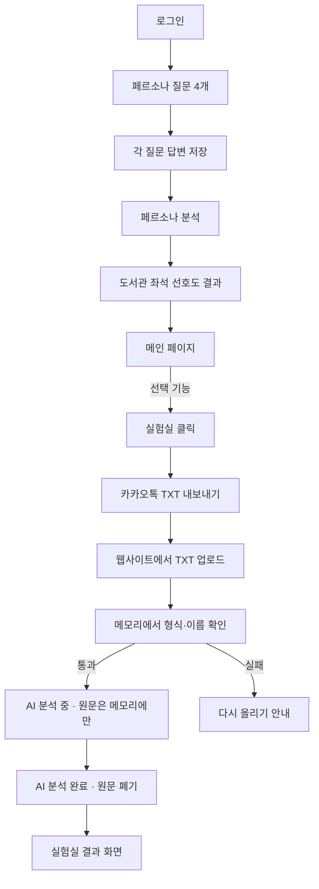
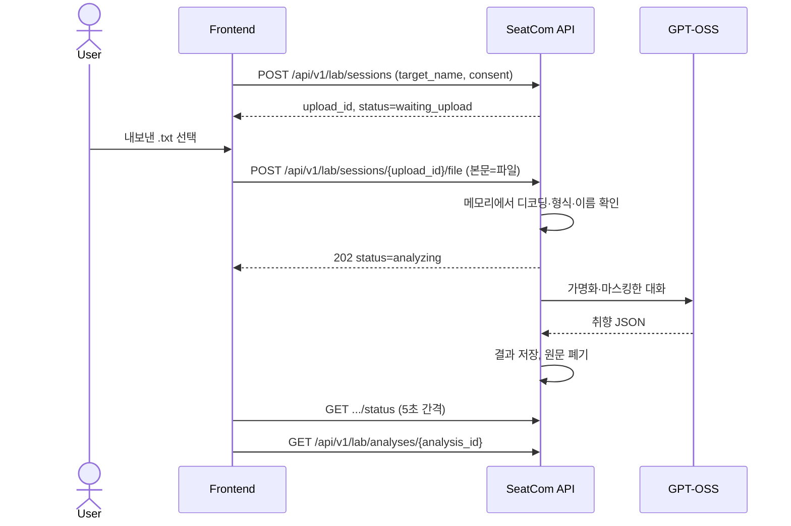

# [API Specification] SeatCom 페르소나 기반 도서관 추천 및 카카오톡 AI 실험실

> **Version:** 2.1  
> **Framework:** FastAPI  
> **API Format:** REST API / JSON  
> **Status:** Frontend–Backend API Contract  
> **Last Updated:** 2026-11-15

---

# 1. Overview

SeatCom은 사용자의 도서관 이용 성향을 분석하여 적합한 좌석이나 공간을 추천하는 서비스입니다.

서비스는 크게 두 가지 기능으로 구성됩니다.

## 1.1 페르소나 분석 (Main Feature)

사용자는 로그인 이후 **4개의 간단한 질문**에 답변하여 자신의 좌석 선호도를 설정할 수 있습니다.

- 로그인 후 4개의 질문 제공
- 각 질문의 선택지를 클릭하여 답변
- 각 답변을 백엔드 API로 저장
- 모든 질문에 응답하면 페르소나 분석 실행
- 사용자 선호 조건에 맞는 좌석 및 공간 추천
- 분석 결과 저장 및 재조회 지원

카카오톡 분석을 이용하지 않아도 기본 서비스를 이용할 수 있습니다.

## 1.2 실험실 — 카카오톡 AI 분석 (Experimental Feature)

기본 페르소나 분석을 완료한 사용자가 선택적으로 이용하는 추가 기능입니다.

사용자는 카카오톡 대화 내용을 TXT로 내보내 **웹사이트에서 직접 업로드**합니다.

서버는 업로드된 파일을 **메모리에서만** 읽어 AI 분석을 실행하고, 분석 결과만 저장합니다. 대화 원문은 디스크·DB·로그 어디에도 저장하지 않습니다.

- 카카오톡 대화 내보내기 튜토리얼
- 웹 업로드(로그인한 본인 세션에만, 파일 바이트를 본문 그대로 전송)
- 형식 확인(카카오톡 TXT인지, 입력한 이름의 메시지가 있는지)
- GPT-OSS 기반 대화 분석(참여자 이름 가명화, 이메일·URL·긴 숫자 마스킹 후 전송)
- 분석 진행 상태 확인
- 분석 결과 조회

**기본 페르소나 분석과 카카오톡 AI 분석 결과는 별도로 저장합니다.**

---

# 2. Overall User Flow



## 핵심 정책

1. 기본 온보딩은 페르소나 4문항으로 구성합니다.
2. 사용자는 질문에 답변한 후 기본 서비스를 이용할 수 있습니다.
3. 카카오톡 분석은 선택적으로 진행합니다.
4. 카카오톡 데이터를 제공하지 않아도 기본 기능은 제한되지 않습니다.
5. 설문 결과와 AI 분석 결과는 별도로 보관합니다.
6. 사용자는 본인의 분석 상태 및 결과만 조회할 수 있습니다.

---

# 3. Common API Rules

## 3.1 API 기본 설정

| 항목 | 내용 |
|---|---|
| Base URL | `https://api.example.com` |
| API Version | `v1` |
| User API Prefix | `/api/v1` |
| Content-Type | `application/json` |
| Authentication | Bearer Token |
| Response Format | JSON |
| Framework | FastAPI |

> Base URL 및 인증 방식은 배포 환경에 따라 확정합니다.

## 3.2 사용자 API 인증

모든 사용자용 API는 다음 인증 헤더를 사용합니다.

```http
Authorization: Bearer <ACCESS_TOKEN>
Content-Type: application/json
```

사용자 ID는 인증된 세션에서 조회합니다.

프론트엔드가 임의의 사용자 ID를 전달하여 타인의 정보를 조회하거나 수정할 수 없도록 합니다.

## 3.3 서버 간 인증

없음. 예전 메일 수집 방식의 내부 API(`/internal/v1/lab/*`)는 제거했습니다.

## 3.4 공통 HTTP Status

| HTTP Status | 의미 |
|---|---|
| 200 | 요청 성공 |
| 201 | 리소스 생성 완료 |
| 202 | 비동기 작업 접수 |
| 400 | 잘못된 요청 |
| 401 | 인증 실패 |
| 403 | 접근 권한 없음 |
| 404 | 데이터 없음 |
| 409 | 중복 또는 상태 충돌 |
| 410 | 세션 만료 |
| 422 | 입력값 검증 실패 |
| 500 | 서버 오류 |
| 502 | 외부 서버 연동 실패 |
| 503 | AI 서비스 이용 불가 |

---

# Part A. 페르소나 분석 API

# 4. 페르소나 질문 정의

총 4개의 필수 질문을 제공합니다.

## 4.1 질문 및 선택지

| # | Question ID | 질문 | 선택지 |
|---|---|---|---|
| 1 | `outlet` | 노트북을 주로 사용하시나요? (또는 주로 콘센트가 필요하신가요?) | 네 / 아니오 |
| 2 | `hvac_proximity` | 에어컨과 가까운 것을 선호하시나요? | 네 / 아니오 / 상관없음 |
| 3 | `noise_sensitivity` | 소음에 민감하신가요? | 많이 / 조금 / 괜찮아요 |
| 4 | `partition` | 칸막이가 있는 자리를 선호하시나요? | 네 / 아니오 / 상관없음 |

## 4.2 답변 코드

### Q1 — 콘센트 필요 여부

| 표시 | Value |
|---|---|
| 네 | `required` |
| 아니오 | `not_required` |

### Q2 — 에어컨 거리 선호

| 표시 | Value |
|---|---|
| 네 | `near` |
| 아니오 | `not_near` |
| 상관없음 | `no_preference` |

### Q3 — 소음 민감도

| 표시 | Value |
|---|---|
| 많이 | `high` |
| 조금 | `low` |
| 괜찮아요 | `none` |

### Q4 — 칸막이 선호

| 표시 | Value |
|---|---|
| 네 | `yes` |
| 아니오 | `no` |
| 상관없음 | `no_preference` |

> Q1은 노트북 사용과 콘센트 필요 여부를 하나의 질문으로 간소화한 것입니다. 실제로 두 조건은 다를 수 있으므로 분석 결과에서는 `outlet`을 콘센트 필요 여부의 근사값으로 사용합니다.

---

# 5. Persona API Endpoints

## API 1. 페르소나 질문 목록 조회

### GET `/api/v1/persona/questions`

사용자에게 표시할 4개의 질문과 선택지를 반환합니다.

### Request JSON

GET 요청이므로 실제 Request Body는 없습니다.

```json
{
  "method": "GET",
  "path": "/api/v1/persona/questions",
  "headers": {
    "Authorization": "Bearer <ACCESS_TOKEN>"
  },
  "body": null
}
```

### Response — 200 OK

```json
{
  "version": "2.1",
  "required_count": 4,
  "questions": [
    {
      "id": "outlet",
      "order": 1,
      "question": "노트북을 주로 사용하시나요? (또는 주로 콘센트가 필요하신가요?)",
      "options": [
        {
          "label": "네",
          "value": "required"
        },
        {
          "label": "아니오",
          "value": "not_required"
        }
      ]
    },
    {
      "id": "hvac_proximity",
      "order": 2,
      "question": "에어컨과 가까운 것을 선호하시나요?",
      "options": [
        {
          "label": "네",
          "value": "near"
        },
        {
          "label": "아니오",
          "value": "not_near"
        },
        {
          "label": "상관없음",
          "value": "no_preference"
        }
      ]
    },
    {
      "id": "noise_sensitivity",
      "order": 3,
      "question": "소음에 민감하신가요?",
      "options": [
        {
          "label": "많이",
          "value": "high"
        },
        {
          "label": "조금",
          "value": "low"
        },
        {
          "label": "괜찮아요",
          "value": "none"
        }
      ]
    },
    {
      "id": "partition",
      "order": 4,
      "question": "칸막이가 있는 자리를 선호하시나요?",
      "options": [
        {
          "label": "네",
          "value": "yes"
        },
        {
          "label": "아니오",
          "value": "no"
        },
        {
          "label": "상관없음",
          "value": "no_preference"
        }
      ]
    }
  ]
}
```

### Frontend Requirements

- API에서 질문 목록을 조회합니다.
- 질문 순서는 `order`를 기준으로 정렬합니다.
- 선택지는 버튼 또는 카드 형태로 표시합니다.
- 총 4개 질문의 진행률을 표시합니다.
- 사용자가 답변을 선택하면 개별 답변 저장 API를 호출합니다.

---

## API 2. 개별 질문 답변 저장

### PUT `/api/v1/persona/answers/{question_id}`

사용자가 각 질문에 답변할 때마다 해당 답변을 저장합니다.

동일 질문에 다시 답변하면 기존 답변을 덮어씁니다.

### Q1. 노트북을 주로 사용하시나요?

**Endpoint**

```http
PUT /api/v1/persona/answers/outlet
```

**Request JSON**

```json
{
  "answer": "required"
}
```

허용 값:

- `required`
- `not_required`

### Q2. 에어컨과 가까운 것을 선호하시나요?

**Endpoint**

```http
PUT /api/v1/persona/answers/hvac_proximity
```

**Request JSON**

```json
{
  "answer": "near"
}
```

허용 값:

- `near`
- `not_near`
- `no_preference`

### Q3. 소음에 민감하신가요?

**Endpoint**

```http
PUT /api/v1/persona/answers/noise_sensitivity
```

**Request JSON**

```json
{
  "answer": "high"
}
```

허용 값:

- `high`
- `low`
- `none`

### Q4. 칸막이가 있는 자리를 선호하시나요?

**Endpoint**

```http
PUT /api/v1/persona/answers/partition
```

**Request JSON**

```json
{
  "answer": "yes"
}
```

허용 값:

- `yes`
- `no`
- `no_preference`

### Response — 200 OK

모든 질문에서 동일한 응답 구조를 사용합니다.

```json
{
  "question_id": "outlet",
  "answer": "required",
  "saved": true,
  "answered_count": 1,
  "required_count": 4,
  "can_analyze": false,
  "updated_at": "2026-11-15T02:00:00+09:00"
}
```

### Response Fields

| Field | Type | 설명 |
|---|---|---|
| `question_id` | string | 저장된 질문 ID |
| `answer` | string | 저장된 답변 |
| `saved` | boolean | 저장 성공 여부 |
| `answered_count` | integer | 현재 답변 완료 개수 |
| `required_count` | integer | 전체 질문 개수 |
| `can_analyze` | boolean | 분석 가능 여부 |
| `updated_at` | string | 마지막 저장 시간 |

### Error — 422

```json
{
  "error": {
    "code": "INVALID_ANSWER",
    "message": "허용되지 않은 답변입니다.",
    "question_id": "partition",
    "allowed_values": [
      "yes",
      "no",
      "no_preference"
    ]
  }
}
```

### Frontend Requirements

1. 사용자가 선택지를 클릭합니다.
2. 선택한 질문 ID와 답변 값을 전송합니다.
3. `saved=true` 응답을 확인합니다.
4. 저장 완료 시 다음 질문으로 이동합니다.
5. 이전 질문으로 돌아가 답변을 수정할 수 있습니다.
6. 4개 질문이 모두 완료되면 분석 버튼을 활성화합니다.

---

## API 3. 저장된 답변 조회

### GET `/api/v1/persona/answers`

이전에 저장한 답변을 조회합니다.

새로고침이나 재로그인 이후 진행 상태를 복원하는 데 사용합니다.

### Request JSON

```json
{
  "method": "GET",
  "path": "/api/v1/persona/answers",
  "headers": {
    "Authorization": "Bearer <ACCESS_TOKEN>"
  },
  "body": null
}
```

### Response — 200 OK

```json
{
  "answers": {
    "outlet": "required",
    "hvac_proximity": "near",
    "noise_sensitivity": "high",
    "partition": "yes"
  },
  "answered_count": 4,
  "required_count": 4,
  "can_analyze": true
}
```

### 미완료 응답 예시

```json
{
  "answers": {
    "outlet": "required",
    "hvac_proximity": "near",
    "noise_sensitivity": null,
    "partition": null
  },
  "answered_count": 2,
  "required_count": 4,
  "can_analyze": false
}
```

### Frontend Requirements

- 기존 답변이 있다면 선택 상태를 복원합니다.
- 미응답 문항은 선택되지 않은 상태로 표시합니다.
- `can_analyze=true`일 때 분석 버튼을 활성화합니다.

---

## API 4. 페르소나 분석 요청

### POST `/api/v1/persona/analyze`

4개 질문에 모두 답변한 후 분석을 실행합니다.

백엔드는 저장된 4개 답변을 기준으로 좌석 선호도 결과를 생성합니다.

### Request JSON

```json
{
  "analysis_type": "library_preference"
}
```

### Response — 200 OK

```json
{
  "analysis_id": "prs_d3a91c02",
  "analysis_method": "persona",
  "status": "completed",
  "seat_preferences": {
    "outlet": "required",
    "hvac_proximity": "near",
    "noise_sensitivity": "high",
    "partition": "yes"
  },
  "source": "self_report",
  "completed_at": "2026-11-15T02:00:00+09:00"
}
```

### Error — 422

모든 질문에 답변하지 않은 경우입니다.

```json
{
  "error": {
    "code": "INCOMPLETE_ANSWERS",
    "message": "모든 질문에 답변해야 합니다.",
    "missing_questions": [
      "noise_sensitivity",
      "partition"
    ]
  }
}
```

### 분석 정책

- 4개 질문 모두 응답해야 분석을 실행합니다.
- 분석 결과는 사용자별로 저장합니다.
- 카카오톡 AI 분석 결과와 별도로 관리합니다.
- 응답은 사용자가 직접 선택한 선호 조건을 그대로 보존합니다.
- 실제 좌석 추천은 좌석 위치 및 시설 정보와 별도로 매칭합니다.

---

## API 5. 페르소나 분석 결과 조회

### GET `/api/v1/persona/result`

현재 사용자의 마지막 페르소나 분석 결과를 조회합니다.

### Request JSON

```json
{
  "method": "GET",
  "path": "/api/v1/persona/result",
  "headers": {
    "Authorization": "Bearer <ACCESS_TOKEN>"
  },
  "body": null
}
```

### Response — 200 OK

```json
{
  "analysis_id": "prs_d3a91c02",
  "analysis_method": "persona",
  "status": "completed",
  "seat_preferences": {
    "outlet": "required",
    "hvac_proximity": "near",
    "noise_sensitivity": "high",
    "partition": "yes"
  },
  "source": "self_report",
  "completed_at": "2026-11-15T02:00:00+09:00"
}
```

### Error — 404

```json
{
  "error": {
    "code": "PERSONA_NOT_FOUND",
    "message": "완료된 페르소나 분석 결과가 없습니다."
  }
}
```

### Frontend Requirements

- 분석 결과를 사용자에게 표시합니다.
- 주요 좌석 선호 조건을 요약합니다.
- 결과 화면에서 메인 페이지로 이동할 수 있도록 합니다.
- 이후 실험실 기능을 선택적으로 이용할 수 있도록 합니다.

---

# Part B. 실험실 — 카카오톡 AI 분석

# 6. Laboratory Overview

카카오톡 대화 TXT를 웹에서 올리면 AI가 좌석 취향을 추정합니다. 기본 페르소나 분석을 마친 **회원 계정**만 쓸 수 있습니다(게스트 토큰 불가).

## 6.1 대화 원문 처리 원칙

| 항목 | 처리 |
|---|---|
| 전송 | `POST .../file` 본문 = TXT 바이트 그대로(`text/plain` 또는 `application/octet-stream`). **multipart 는 거절(415)**: 서버 프레임워크가 큰 파일을 임시파일(디스크)로 내리기 때문 |
| 수신 | 요청 본문을 메모리 버퍼로 읽는다. `Content-Length`와 실제 바이트 모두 `MAX_TXT_BYTES`(기본 5MB)로 제한 |
| 보관 | 프로세스 메모리에만 둔다. 분석이 끝나거나 실패·취소·탈퇴하면 즉시 참조를 버린다. 바이트 버퍼는 0으로 덮어쓴다 |
| 디스크 | 파일·DB·임시파일·로그에 쓰지 않는다. 파일 이름도 저장하지 않는다(파일 이름에 상대방 이름이 들어감). 코어 덤프를 끈다 |
| 로그 | 업로드 ID·예외 종류만 남긴다. 예외 메시지·요청 본문은 남기지 않는다(422 검증 오류도 본문을 돌려주지 않음) |
| 재시작 | 메모리 원문은 사라진다. 분석 중이던 세션은 `failed`(`UPLOAD_LOST`)로 바뀌고 다시 올리도록 안내한다 |
| AI 서버 | 참여자 이름은 `speaker_###`·`TARGET`으로 가명화, 이메일·URL·긴 숫자는 마스킹해서 보낸다 |
| 남는 것 | 분석 결과 JSON(`lab_results`)만. 세션 삭제·회원 탈퇴 시 함께 지운다 |
| 남용 방지 | 사용자당 시간당 업로드 `LAB_UPLOADS_PER_HOUR`(기본 5회, 429), 메모리 대기 상한 `LAB_MAX_PENDING`(기본 6, 503), 동시 분석 `LAB_MAX_CONCURRENT`(기본 2) |

> 메모리 작업 목록은 프로세스 안에 있으므로 백엔드는 **uvicorn 워커 1개**로 실행한다(`deploy/ecosystem.config.cjs`).

## 6.2 Laboratory User Flow



## 6.3 상태

| status | 뜻 |
|---|---|
| `waiting_upload` | 세션 생성, 파일 대기(`UPLOAD_EXPIRY_MINUTES`, 기본 30분) |
| `analyzing` | 파일 수신, 메모리에서 분석 중 |
| `completed` | 분석 완료(원문 폐기) |
| `failed` | 분석 실패 또는 재시작으로 원문 유실(`error.code`) |
| `expired` | 파일을 올리지 않고 시간 초과 |
| `cancelled` | 새 세션을 만들어 이전 대기 세션이 취소됨 |

# 7. Laboratory API Endpoints

## API 6. 실험실 세션 생성 — `POST /api/v1/lab/sessions`

```json
{"target_name": "홍길동", "consent": true}
```

`201`:

```json
{
  "upload_id": "upl_3f1c...",
  "target_name": "홍길동",
  "status": "waiting_upload",
  "upload_url": "/api/v1/lab/sessions/upl_3f1c.../file",
  "max_bytes": 5000000,
  "accepted_content_types": ["text/plain", "application/octet-stream"],
  "expires_at": "2026-11-15T02:30:00+00:00",
  "poll_interval_seconds": 5
}
```

오류: `400 CONSENT_REQUIRED`, `403 ACCOUNT_REQUIRED`(게스트), `404 PERSONA_NOT_FOUND`. 같은 사용자의 이전 `waiting_upload` 세션은 `cancelled`가 된다.

## API 7. 대화 파일 업로드 — `POST /api/v1/lab/sessions/{upload_id}/file`

```http
Authorization: Bearer <ACCESS_TOKEN>
Content-Type: text/plain
<TXT 파일 바이트>
```

브라우저: `fetch(url, {method: 'POST', headers: {'Content-Type': 'text/plain', Authorization}, body: file})` (File 객체를 그대로 본문으로). UTF-8·UTF-8 BOM·CP949·UTF-16을 받는다.

`202`: 상태 조회(API 8)와 같은 모양, `status: "analyzing"`.

| HTTP | code | 언제 |
|---:|---|---|
| 404 | `NOT_FOUND` | 세션이 없거나 **다른 사용자 세션**(존재 여부를 알려 주지 않음) |
| 409 | `UPLOAD_ALREADY_USED` | 이미 파일을 받은 세션 |
| 410 | `UPLOAD_EXPIRED` | 업로드 시간 초과 |
| 413 | `FILE_TOO_LARGE` | `MAX_TXT_BYTES` 초과 |
| 415 | `UNSUPPORTED_MEDIA_TYPE` | multipart·JSON 등 |
| 422 | `INVALID_TXT` | 빈 파일, NUL 바이트, 지원하지 않는 인코딩 |
| 422 | `INVALID_KAKAO_TXT` | 카카오톡 대화 형식이 아님 |
| 422 | `TARGET_NOT_FOUND` | `target_name`의 메시지가 없음 |
| 429 | `TOO_MANY_UPLOADS` | 시간당 업로드 초과 |
| 503 | `LAB_BUSY` | 메모리 대기 상한 |

## API 8. 상태 조회 — `GET /api/v1/lab/sessions/{upload_id}/status`

```json
{
  "upload_id": "upl_3f1c...",
  "status": "analyzing",
  "file_received": true,
  "analysis": {"analysis_id": "lab_9a2e...", "status": "processing", "model": "openai/gpt-oss-120b"},
  "message": "AI가 카카오톡 대화를 분석하고 있습니다. 대화 원문은 서버에 저장하지 않습니다."
}
```

실패 시 `message` 대신 `error: {code, message}` (`AI_ANALYSIS_FAILED`, `UPLOAD_LOST`).

## API 9. 결과 조회 — `GET /api/v1/lab/analyses/{analysis_id}`

```json
{
  "analysis_id": "lab_9a2e...",
  "analysis_method": "kakao_lab",
  "status": "completed",
  "source": "kakao_conversation",
  "analysis": {"participant_id": "TARGET", "behavioral_summary": "...", "preferences": {"outlet": {"preference": "required", "confidence": 0.8, "inference_type": "explicit", "reason": "..."}}, "evidence": [], "seat_recommendation": "...", "follow_up_question": ""},
  "completed_at": "2026-11-15T02:05:00+00:00"
}
```

분석 중이면 `409 ANALYSIS_NOT_READY`, 다른 사용자 결과는 `404`.

## API 10. 세션 삭제 — `DELETE /api/v1/lab/sessions/{upload_id}`

세션과 분석 결과를 지운다. 분석 대기 중이면 메모리 원문도 즉시 버리고, 진행 중인 분석은 결과를 저장하지 않는다.

---

# Part C. Frontend Integration

# 8. 프론트엔드 처리 순서

| Step | API | 화면 | 성공 조건 |
|---:|---|---|---|
| 1 | `GET /api/v1/persona/questions` | 페르소나 질문 4개 | 질문 로딩 완료 |
| 2 | `PUT /api/v1/persona/answers/{question_id}` | 개별 답변 저장 | `saved=true` |
| 3 | `GET /api/v1/persona/answers` | 답변 진행 상태 복원 | 응답 정상 |
| 4 | `POST /api/v1/persona/analyze` | 페르소나 분석 | `completed` |
| 5 | `GET /api/v1/persona/result` | 분석 결과 표시 | 결과 조회 완료 |
| 6 | `POST /api/v1/lab/sessions` | 실험실 시작 | `upload_id` 발급, `waiting_upload` |
| 7 | `POST /api/v1/lab/sessions/{upload_id}/file` | TXT 업로드 | `202`, `analyzing` |
| 8 | `GET /api/v1/lab/sessions/{upload_id}/status` | AI 분석 중 | `analyzing` |
| 9 | 동일 API | 분석 완료 | `completed` |
| 10 | `GET /api/v1/lab/analyses/{analysis_id}` | 실험실 결과 | 결과 조회 완료 |

내부 API는 프론트엔드에서 직접 호출하지 않습니다.

---

# 9. Frontend UI Requirements

## 9.1 페르소나 질문 화면

- 질문 제목 표시
- 선택지 버튼
- 현재 질문 번호 표시
- 진행률 표시 (1/4, 2/4, 3/4, 4/4)
- 이전 버튼
- 다음 버튼
- 선택 결과 저장
- 기존 답변 복원

## 9.2 페르소나 분석 결과 화면

- 사용자 좌석 선호도 표시
- 콘센트 필요 여부
- 에어컨 거리 선호
- 소음 민감도
- 칸막이 선호
- 메인 페이지 이동 버튼

## 9.3 실험실 시작 화면

- 실험실 기능 소개
- 카카오톡 데이터 분석 안내
- 데이터 수집 및 처리 동의
- 분석 시작 버튼

## 9.4 카카오톡 TXT 업로드 화면

- 카카오톡 대화 내보내기 튜토리얼(Android: 내 파일에 저장, iPhone: 파일에 저장)
- `.txt` 파일 선택(드래그 앤 드롭 가능), 확장자·크기 사전 확인
- 파일 내용은 브라우저 저장소(localStorage 등)에 넣지 않는다. 저장하는 것은 `upload_id`·상태뿐
- "서버에 저장하지 않음" 안내와 업로드 후 휴대폰의 TXT 삭제 권장

## 9.5 분석 상태 화면

| 상태 | 표시 메시지 |
|---|---|
| `waiting_upload` | 아직 파일을 받지 못했어요. |
| `analyzing` | AI가 대화를 분석하고 있어요. |
| `completed` | 분석이 끝났어요. |
| `failed` | 처리 중 문제가 생겼어요(`UPLOAD_LOST`면 다시 올리기 안내). |
| `expired` | 업로드 시간이 지났어요. |

## 9.6 실험실 결과 화면

- AI 분석 결과 요약
- 선호도별 분석 결과
- 추정 신뢰도 표시
- 분석 근거 설명
- 기본 페르소나 결과와 비교 (선택 기능)
- 메인 페이지 이동 버튼

---

# 10. Common Error Response

모든 API는 일관된 오류 응답 구조를 사용합니다.

### Error JSON

```json
{
  "error": {
    "code": "INVALID_ANSWER",
    "message": "요청한 답변을 처리할 수 없습니다.",
    "request_id": "req_a7e91c"
  }
}
```

### Error Codes

| HTTP | Error Code | 설명 |
|---:|---|---|
| 400 | `CONSENT_REQUIRED` | 동의 누락 |
| 401 | `UNAUTHORIZED` | 인증 실패 |
| 403 | `FORBIDDEN` | 접근 권한 없음 |
| 404 | `NOT_FOUND` | 요청한 데이터 없음 |
| 404 | `PERSONA_NOT_FOUND` | 페르소나 분석 결과 없음 |
| 403 | `ACCOUNT_REQUIRED` | 게스트 계정은 실험실 불가 |
| 409 | `UPLOAD_ALREADY_USED` | 중복 업로드 |
| 410 | `UPLOAD_EXPIRED` | 업로드 시간 초과 |
| 413 | `FILE_TOO_LARGE` | 파일 크기 초과 |
| 415 | `UNSUPPORTED_MEDIA_TYPE` | multipart 등 허용하지 않는 업로드 형식 |
| 422 | `INVALID_ANSWER` | 답변 값 오류 |
| 422 | `INCOMPLETE_ANSWERS` | 질문 미완료 |
| 422 | `INVALID_TXT` / `INVALID_KAKAO_TXT` / `TARGET_NOT_FOUND` | TXT 형식·대상 이름 오류 |
| 429 | `TOO_MANY_UPLOADS` | 업로드 횟수 제한 |
| 503 | `LAB_BUSY` | 분석 대기 상한 |

---

# 11. Security & Privacy Requirements

- 페르소나 분석은 카카오톡 데이터 없이 이용할 수 있어야 합니다.
- 실험실 분석은 사용자가 명시적으로 선택한 경우에만 실행합니다.
- 카카오톡 TXT 전송 전에 개인정보 수집 목적을 안내합니다.
- 데이터 보관 기간 및 삭제 방법을 안내합니다.
- 제3자 개인정보가 포함될 수 있다는 점을 고지합니다.
- 불필요한 개인정보는 제거하도록 안내합니다.
- 업로드는 로그인한 본인의 세션에만 할 수 있고, 다른 사용자의 세션은 존재 여부도 알려 주지 않습니다.
- **카카오톡 TXT는 서버 디스크·DB·임시파일·로그에 저장하지 않습니다.** 메모리에서만 분석하고 바로 버립니다(6.1).
- 업로드는 multipart 가 아닌 raw body 로만 받아 임시파일 생성을 막습니다.
- 파일 이름은 저장하지 않습니다.
- 원본 TXT 데이터는 브라우저 Local Storage에 저장하지 않습니다.
- **운영 배포는 HTTPS 뒤에 둡니다.** 평문 HTTP면 대화가 네트워크에서 그대로 보입니다.
- 분석 결과는 해당 사용자만 조회할 수 있습니다.
- 사용자 요청에 따른 데이터 삭제 기능을 지원하도록 설계합니다.
- 서버 로그에 카카오톡 대화 원문을 기록하지 않습니다.

---

# 12. Acceptance Criteria

## 12.1 Persona

- [ ] 로그인 후 4개의 질문이 정상적으로 표시됩니다.
- [ ] 각 질문에서 선택지를 선택할 수 있습니다.
- [ ] 질문별 답변이 API를 통해 저장됩니다.
- [ ] 이전 질문의 답변을 수정할 수 있습니다.
- [ ] 새로고침 후에도 답변이 복원됩니다.
- [ ] 모든 질문에 응답해야 분석할 수 있습니다.
- [ ] 4개의 답변을 기반으로 분석 결과를 생성합니다.
- [ ] 분석 결과를 조회할 수 있습니다.
- [ ] 카카오톡 분석 없이 메인 서비스를 이용할 수 있습니다.

## 12.2 Laboratory

- [ ] 실험실 기능을 선택적으로 실행할 수 있습니다.
- [ ] 카카오톡 TXT 내보내기 튜토리얼이 제공됩니다.
- [ ] 웹에서 TXT를 올리면 `202 analyzing`이 됩니다.
- [ ] 업로드 후 서버의 디스크·DB·로그에 대화 원문이 없습니다(`backend/tests/test_api.py`).
- [ ] 형식이 틀리거나 이름이 없으면 즉시 422로 알려 줍니다.
- [ ] 프론트엔드에서 AI 분석 진행 상태를 확인할 수 있습니다.
- [ ] AI 분석 완료 후 결과를 조회할 수 있습니다.
- [ ] 데이터 처리 및 삭제 정책을 안내합니다.

---

# 13. Expected Deliverables

## Frontend

- 페르소나 4문항 질문 UI
- 질문별 답변 저장 로직
- 진행률 및 상태 관리
- 분석 결과 UI
- 실험실 진입 화면
- 카카오톡 TXT 내보내기 튜토리얼
- TXT 업로드 UI
- AI 분석 진행 UI
- 실험실 결과 화면
- API 연동 및 예외 처리

## Backend

- 4문항 질문 조회 API
- 개별 답변 저장 API
- 답변 복원 API
- 페르소나 분석 API
- 페르소나 결과 조회 API
- 실험실 세션 생성 API
- TXT 업로드 API(메모리 전용)
- AI 분석 작업 실행
- AI 분석 상태 조회 API
- AI 분석 결과 조회 API
- 사용자 및 분석 결과 DB 연동

---

# 14. API Endpoint Summary

| # | Method | Endpoint | Description |
|---:|---|---|---|
| 1 | GET | `/api/v1/persona/questions` | 4문항 질문 조회 |
| 2 | PUT | `/api/v1/persona/answers/{question_id}` | 개별 답변 저장 |
| 3 | GET | `/api/v1/persona/answers` | 답변 복원 |
| 4 | POST | `/api/v1/persona/analyze` | 페르소나 분석 |
| 5 | GET | `/api/v1/persona/result` | 페르소나 결과 조회 |
| 6 | POST | `/api/v1/lab/sessions` | 실험실 세션 생성 |
| 7 | POST | `/api/v1/lab/sessions/{upload_id}/file` | 카카오톡 TXT 업로드(메모리 전용) |
| 8 | GET | `/api/v1/lab/sessions/{upload_id}/status` | 실험실 상태 조회 |
| 9 | GET | `/api/v1/lab/analyses/{analysis_id}` | AI 분석 결과 조회 |
| 10 | DELETE | `/api/v1/lab/sessions/{upload_id}` | 세션·결과 삭제 |

---

# 15. Frontend–Backend Final Agreement

1. 기본 온보딩 질문은 **총 4개**입니다.
2. 질문 ID는 `outlet`, `hvac_proximity`, `noise_sensitivity`, `partition`입니다.
3. 각 답변은 개별 `PUT` API로 저장합니다.
4. 4개 질문에 모두 답변한 경우 페르소나 분석을 실행합니다.
5. 기본 서비스는 카카오톡 데이터 없이 이용할 수 있습니다.
6. 실험실은 선택 기능으로 제공됩니다.
7. 카카오톡 TXT는 웹에서 raw body 로 업로드하고, 서버는 저장하지 않습니다.
8. 프론트엔드는 상태 조회 API로 진행 상황을 확인합니다.
9. 업로드가 형식·이름 확인을 통과하면 곧바로 GPT-OSS 분석을 시작합니다.
10. 분석이 끝나면 원문은 버리고 결과만 남깁니다.
11. AI 분석 결과는 기본 페르소나 결과와 별도로 저장합니다.
12. 업로드 API를 뺀 모든 API는 JSON 기반으로 통신합니다.

---

**Note:** 본 문서는 FastAPI 구현을 위한 프론트엔드–백엔드 API 계약 초안입니다. 예시 JSON은 실제 실행 결과가 아니며, API 경로와 인증 및 외부 서비스 연동 설정은 최종 구현 시 확정합니다.
