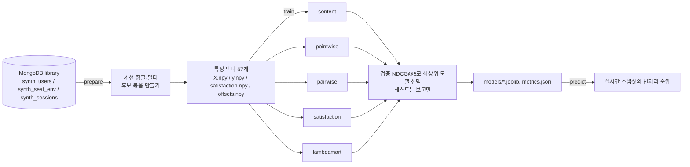

# 좌석 추천 모델 훈련 가이드 (`recommender/seatrec`)

이 문서는 `prepare` → `train` 두 명령이 내부에서 무엇을 하는지 단계별로 설명한다. 실제 실행 결과와 결과를 해석할 때의 주의점도 함께 적는다.

- 대상 코드: `recommender/seatrec/{__main__,data,features,models,predict}.py`
- 대상 데이터: MongoDB `library` DB의 `synth_*` 컬렉션, 또는 같은 내용의 `data/libraries/synthetic/*.jsonl`
- 기준 실행: 2026-11-15, 사용자 3,000명 · 세션 163,767건(생성기 `synth-1.0`, seed 20261114)

---

## 0. 한 번에 실행

저장소 루트에서 실행한다. 환경은 루트 `pyproject.toml`의 uv 환경(Python 3.11)이다.

```bash
cd /home/stadium/2026-IST-TECH-SeatCom-Model
uv sync                                                          # 최초 1회: .venv 생성

# (데이터가 없거나 다시 만들 때) 합성 데이터 생성 → MongoDB 적재
uv run data/libraries/scripts/generate_synthetic.py --users 3000 --sessions 165000
uv run data/libraries/scripts/load_mongo.py

# 학습 데이터 만들기 → 5개 모델 학습·평가
uv run python -m recommender.seatrec prepare --source mongo      # DB에서 읽기
uv run python -m recommender.seatrec train
```

- `--source mongo`를 빼면 로컬 `data/libraries/synthetic/*.jsonl`을 읽는다. 지금은 두 소스의 내용이 같다(건수와 manifest 확인). 하지만 **DB에 적재된 그대로 학습하려면 `--source mongo`를 붙인다**.
- 기준 실행 시간(32코어 서버):
  - `prepare`: 약 68초, 최대 메모리 약 1.7GB
  - `train`: 약 65초, 최대 메모리 약 0.7GB
- 결과는 `recommender/artifacts/` 아래에 저장되고 Git에서는 제외된다.

빠른 시험(표본 5,000세션):

```bash
uv run python -m recommender.seatrec prepare --source mongo --max-sessions 5000 --output /tmp/seatrec/data
uv run python -m recommender.seatrec train --data /tmp/seatrec/data --output /tmp/seatrec/models --epochs 3 --rounds 30
```

테스트:

```bash
uv run python -m unittest discover -s recommender/tests -v
```

---

## 1. 전체 흐름



학습 문제는 **"한 세션에서 이 사람이 고른 좌석을 비교 좌석들보다 위에 올리는 순위 학습"**이다.

- 세션 하나가 질의(query) 하나다.
- 후보는 선택 좌석 1개와, 같은 시각에 비어 있던 비교 좌석 최대 10개다.
- 정답(label)은 선택 좌석이 1이고 나머지가 0이다.

---

## 2. 입력 데이터: 무엇을 읽고 무엇을 읽지 않는가

`data.py`의 `FIELDS`가 읽는 필드를 허용 목록으로 고정한다. 정답을 누설할 수 있는 필드는 아예 읽지 않는다.

| 컬렉션 | 읽는 필드 | 용도 |
|---|---|---|
| `synth_users` | `user_id`, `preference_profile`, `requirements` | 관측 취향(카카오톡 분석 결과를 변환한 target·importance), 필수 조건 |
| `synth_seat_env` | `scenario_id`, `seat_id`, `library_id`, `room_id`, `features`, `brightness_by_slot`, `raw` | 좌석 특성 12개, 시간대별 밝기, 소음(`raw.noise_index`) |
| `synth_sessions` | `session_id`, `user_id`, `scenario_id`, `library_id`, `room_id`, `time_slot`, `occurred_at`, `occupancy_rate`, `chosen_seat_id`, `negative_seat_ids`, `satisfaction` | 세션 맥락, 정답(선택 좌석), 비교 좌석, 만족도 |

**읽지 않는 필드**(모델이 보면 안 되는 정답·사후 정보):

- `latent`: 진짜 취향, 효용 가중치, 소음 회피, 합리성, 추천 신뢰
- `archetype`
- `is_correct_vs_latent`
- `chosen_true_utility`
- `chosen_preference_fit`
- `exposed`: 추천 노출 순위와 점수
- `choice_origin`
- `synth_events`

`satisfaction`은 만족도 모델의 회귀 정답으로만 쓰고, 특성으로는 쓰지 않는다. 테스트 `test_feature_allowlist_and_slot`이 이 차단을 검사한다. 사용자 정보에 `latent`를 넣거나 세션에 `chosen_true_utility` 같은 값을 넣어도 특성 벡터가 바뀌지 않는지 확인한다.

---

## 3. `prepare` 단계 상세 (`data.py: prepare`)

### 3.1 옵션

| 옵션 | 기본값 | 의미 |
|---|---|---|
| `--source` | `jsonl` | `jsonl`이면 로컬 파일, `mongo`이면 DB에서 읽는다 |
| `--data-dir` | `data/libraries/synthetic` | JSONL 위치 |
| `--env` / `--db` | 루트 `.env` / `library` | Mongo 접속 정보(`MONGO_HOST/PORT/USER/PASSWORD/AUTH_DB`). 환경변수가 우선한다 |
| `--output` | `recommender/artifacts/dataset` | 출력 폴더. 같은 경로를 쓰면 덮어쓴다 |
| `--negatives` | 10 | 세션당 비교 좌석 최대 개수(세션에 저장된 비교 좌석은 최대 20개) |
| `--max-sessions` | 0(전체) | seed로 고정한 무작위 표본 크기 |
| `--seed` | 20261114 | 비교 좌석 표본과 세션 표본의 난수 시드 |

### 3.2 처리 순서

1. **적재**
   - 사용자를 `user_id`로, 좌석 환경을 `(scenario_id, seat_id)`로 사전에 담는다.
   - 세션은 리스트로 담는다.
2. **시간 정렬**
   - `occurred_at`을 실제 시각으로 바꿔 정렬한다. 시각이 같으면 `session_id` 순서다.
   - `--max-sessions`를 주면 이 단계에서 무작위 표본을 뽑은 뒤 다시 시간 순서를 지킨다.
3. **세션 필터.** 한 세션이라도 중복되면 오류로 멈춘다. 제외 사유와 기준 실행의 건수는 다음과 같다.

   | 사유 | 건수 | 설명 |
   |---|---|---|
   | `no_choice` | 24,677 | 앉을 수 있는 좌석이 없어 선택하지 않은 세션 |
   | `ineligible_choice` | 679 | 선택한 좌석이 **관측된** 필수 조건(예: 노트북 허용=1)을 어긴 세션. 카카오톡 분석이 노트북 사용을 잘못 추정하면 생긴다 |
   | `no_negative` | 1,340 | 조건을 만족하는 비교 좌석이 하나도 없는 세션 |

4. **비교 좌석(negative) 만들기**
   - 생성기가 세션마다 저장한 `negative_seat_ids`를 쓴다. 그 시각에 비어 있던 다른 좌석 중 최대 20개를 무작위로 뽑은 표본이다.
   - 이 중 필수 조건을 만족하는 좌석만 남긴다(`features.eligible`).
   - 10개보다 많으면 seed로 10개를 뽑는다.
5. **후보 묶음**
   - `ids = sorted([선택 좌석] + 비교 좌석)`처럼 **좌석 ID 순서로 정렬**한다.
   - 이렇게 하면 정답이 항상 첫 번째 같은 자리에 오지 않는다. 점수가 같을 때 정답이 유리해지는 일도 없다.
6. **특성 계산**
   - 후보마다 `features.vector(user, seat, session)`로 67차원 벡터를 만든다(4장).
   - 후보가 다른 도서관이나 다른 열람실에 속하면 오류로 멈춘다.
7. **시간순 분할 70/15/15**
   - 세션 시각 기준으로 앞 70%는 학습, 다음 15%는 검증, 마지막 15%는 테스트에 넣는다.
   - 같은 시각의 세션은 한 분할에만 들어간다.
   - 한 세션의 후보는 항상 함께 이동한다.
   - 같은 사용자는 여러 분할에 걸쳐 나온다. 이건 의도된 설계다. 과거 이력으로 미래 선택을 맞히는 문제이기 때문이다. 다만 처음 보는 사용자에 대한 평가는 아니다.
8. **저장**

### 3.3 출력 파일

| 파일 | 형태 | 기준 실행 값 |
|---|---|---|
| `X.npy` | float32 메모리 매핑 행렬(행=후보, 열=67) | 1,422,402 × 67 (약 380MB) |
| `y.npy` | int8, 선택이면 1, 아니면 0 | 1,422,402 |
| `satisfaction.npy` | float32, 선택 좌석 행만 만족도, 나머지 NaN | 137,071개 유효 |
| `offsets.npy` | 세션 경계. 세션 g의 후보는 `X[offsets[g]:offsets[g+1]]` | 137,072 |
| `groups.jsonl` | 세션 순서대로 `session_id`, `user_id`, `occurred_at` | 137,071줄 |
| `manifest.json` | 특성 이름, 분할 위치, 제외 건수, 소스 | 아래 참고 |

기준 실행의 `manifest.json` 핵심 값:

```json
{"rows": 1422402, "groups": 137071,
 "group_splits": [0, 95949, 116510, 137071],
 "row_splits":   [0, 995791, 1209477, 1422402],
 "skipped": {"no_choice": 24677, "ineligible_choice": 679, "no_negative": 1340},
 "split": "chronological 70/15/15, timestamp ties stay together",
 "evaluation": "sampled eligible negatives; not full available-seat ranking"}
```

학습은 95,949세션, 검증과 테스트는 각각 20,561세션이다. 세션당 평균 후보는 10.36개이고, 이 중 정답은 1개다.

---

## 4. 특성 67개 (`features.py: vector`)

학습과 실시간 추론이 **같은 함수**를 쓴다. 그래서 학습 때와 서비스 때 특성이 어긋나지 않는다.

좌석 특성 12개(`FEATURES`):
`laptopAllowed, keyboardAllowed, partition, outletAvailable, windowProximity, toiletProximity, entranceProximity, brightness, airflow, deskHeight, deskWidth, viewQuality`

| 블록 | 개수 | 정의 |
|---|---|---|
| `seat:*` | 12 | 좌석 특성값(0~1). `brightness`는 그 세션 시간대의 값(`brightness_by_slot[time_slot]`)으로 바꾼다. 값이 없으면 0.5 |
| `known:*` | 12 | 값이 있으면 1, 결측이면 0. 합성 데이터에서는 항상 1이다(실데이터 대비용) |
| `target:*` | 12 | 사용자 관측 프로필의 목표값. 프로필에 없으면 0 |
| `importance:*` | 12 | 관측 프로필의 중요도. 프로필에 없으면 0 |
| `match:*` | 12 | `importance × known × (1 − abs(seat − target))`. 특성별 취향 일치도 |
| `noise` | 1 | `raw.noise_index`(없으면 0.5) |
| `noise_known` | 1 | 소음값이 있으면 1 |
| `occupancy` | 1 | 세션 시점의 열람실 점유율 |
| `slot:morning/noon/evening` | 3 | 시간대 원-핫 |
| `preference_score` | 1 | `Σ match / Σ(importance × known)`. 명세 6.2의 기준 점수이며, 프로필이 비어 있으면 0.5 |

모든 값은 0~1 사이여야 한다. 범위를 벗어나거나 NaN이면 오류로 멈춘다. 기준 데이터에서 위반은 0건이다.

**들어가지 않는 것**(중요):

- 사용자 ID나 좌석 ID 임베딩
- **그 사용자의 과거 선택 이력에서 만든 특성**(예: 지금까지 고른 좌석의 평균 특성, 자주 고른 좌석)

따라서 현재 모델은 "관측 프로필과 좌석 특성을 어떻게 섞을지"를 **모든 사용자에 공통으로** 배운다. 한 사람의 이력에서 그 사람만의 숨은 취향을 배우지는 않는다(9장).

---

## 5. 모델 5종 (`models.py: train`)

모든 모델은 같은 `X`와 같은 분할을 쓴다. 각 모델은 `{method, features, schema_version, seed, threads, model}` 묶음(bundle)으로 `joblib`에 저장된다. 불러올 때는 특성 이름 목록이 코드와 같은지 검사한다.

### 5.1 `content`: 학습 없는 기준선

- 점수는 `X[:, -1]`, 즉 `preference_score` 그대로다.
- 관측 프로필이 원하는 좌석일수록 위에 온다.
- 생성기가 추천을 노출할 때 쓴 공식과 같다(합성 세션의 `exposed` top-5가 이 점수 순위다).

### 5.2 `pointwise`: SGD 로지스틱 회귀

- 각 후보를 따로 보고 "선택이면 1, 아니면 0"을 분류한다.
- 모델: `SGDClassifier(loss='log_loss', alpha=1e-4, eta0=0.01, learning_rate='constant', average=True)`, 절편 사용
- 학습 방법:
  - 학습 세션을 512개씩 묶는다. 한 묶음 안에서는 같은 세션의 정답과 비교 좌석이 함께 들어간다.
  - 묶음 순서를 epoch마다 섞어 `partial_fit`을 한다. 행렬 전체를 메모리로 복사하지 않는다.
  - epoch마다 검증 NDCG@5를 재고, 가장 좋은 epoch의 모델을 남긴다(`selected_epoch`).
- 옵션: `--epochs`(기본 10)

### 5.3 `pairwise`: 쌍 비교 로지스틱(선형 RankNet)

- 같은 세션 안에서 `x(선택) − x(비교)` 차이 벡터를 만든다. 학습 목표는 이 차이가 양수가 되도록 하는 것이다.
- 대칭을 맞추려고 `+diff → 1`과 `−diff → 0`을 함께 넣는다. 절편은 쓰지 않는다. 순위만 중요하기 때문이다.
- 나머지(512세션 묶음, epoch 선택)는 pointwise와 같다.
- 사용자 ID 행렬분해(BPR-MF)가 아니다. 특성 기반 선형 모델이다.

### 5.4 `satisfaction`: 만족도 회귀(HistGradientBoosting)

- 학습 데이터: **학습 구간의 선택 좌석 행만** 쓴다. 만족도가 있는 행이 이것뿐이다.
- 정답: `satisfaction`(0~1, 선택 좌석이 잠재 취향에 맞을수록 높음)
- 모델: `HistGradientBoostingRegressor(max_iter=--rounds, max_leaf_nodes=15, l2_regularization=1)`, 조기 종료 없음
- 순위: 모든 후보의 만족도를 예측해 높은 순으로 정렬한다.
- 주의: 학습은 선택된 좌석만으로 하고, 평가는 선택되지 않은 좌석에도 적용한다. 선택 편향이 있다.

### 5.5 `lambdamart`: LightGBM LambdaRank

- 세션을 질의 그룹으로 보고 NDCG를 직접 최적화한다.
- 모델: `LGBMRanker(objective='lambdarank', n_estimators=--rounds, learning_rate=0.05, num_leaves=15, reg_lambda=1, deterministic=True)`
- 조기 종료: 검증 NDCG@5가 20라운드 동안 나아지지 않으면 멈춘다.
- 옵션: `--rounds`(기본 150), `--threads`(기본 2)

### 5.6 `train` 옵션

| 옵션 | 기본값 | 의미 |
|---|---|---|
| `--data` | `recommender/artifacts/dataset` | `prepare` 출력 |
| `--output` | `recommender/artifacts/models` | 모델·지표 저장 위치 |
| `--models` | 5종 전부 | 예: `--models content pairwise lambdamart` |
| `--epochs` | 10 | SGD epoch |
| `--rounds` | 150 | 트리 개수 상한(만족도 GBDT와 LambdaMART) |
| `--threads` | 2 | BLAS·LightGBM 스레드. 서버에서는 8~16으로 올려도 된다 |
| `--seed` | 20261114 | 모델 난수 |

---

## 6. 평가 (`models.py: evaluate`)

세션마다 후보 점수를 내림차순으로 정렬한다. 동점이면 원래 순서(좌석 ID 순)를 유지한다. 그다음 정답 좌석의 순위 r을 구한다.

| 지표 | 정의 |
|---|---|
| `hit@5` | r ≤ 5인 세션 비율 |
| `ndcg@5` | r ≤ 5이면 1/log2(r+1), 아니면 0인 값의 평균(정답이 1개라 IDCG=1) |
| `mrr` | 1/r의 평균 |
| `top1` | r = 1인 비율 |
| `mean_candidates` | 세션당 평균 후보 수 |
| `satisfaction_rmse_chosen_only` | 만족도 모델에만 있음. 선택 좌석의 예측 만족도와 실제 만족도의 RMSE |

- **모델 선택**은 검증 NDCG@5로만 한다(`best_model_by_validation_ndcg5`). 테스트는 보고용이다.
- **무작위 기준:** 후보가 약 10.4개이므로 무작위 순위면 top1 ≈ 0.096, hit@5 ≈ 0.48이다.

---

## 7. 산출물

```
recommender/artifacts/
├── dataset/   X.npy  y.npy  satisfaction.npy  offsets.npy  groups.jsonl  manifest.json
└── models/    content.joblib  pointwise.joblib  pairwise.joblib  satisfaction.joblib  lambdamart.joblib
               metrics.json   # 모델별 validation/test 지표, 최상위 모델, 데이터 manifest, 실행 설정
```

`joblib` 파일은 pickle이다. 직접 만든 파일만 불러온다.

---

## 8. 기준 실행 결과 (2026-11-15, 전체 163,767세션)

| 모델 | 검증 NDCG@5 | 테스트 Hit@5 | 테스트 NDCG@5 | 테스트 MRR | 테스트 Top1 |
|---|---|---|---|---|---|
| **content (기준선)** | **0.7754** | 0.9285 | **0.7724** | **0.7291** | **0.5801** |
| lambdamart | 0.7737 | 0.9324 | 0.7720 | 0.7271 | 0.5756 |
| pairwise | 0.7673 | **0.9333** | 0.7657 | 0.7185 | 0.5633 |
| pointwise | 0.7476 | 0.9233 | 0.7424 | 0.6923 | 0.5275 |
| satisfaction | 0.7277 | 0.9084 | 0.7245 | 0.6756 | 0.5094 |

- 검증 기준 최상위는 **`content`(학습 없는 기준선)**이다.
- 만족도 모델의 선택 좌석 RMSE는 0.081이다.
- pointwise와 pairwise는 마지막 epoch(10)가 선택됐다. LambdaMART는 상한 150라운드까지 조기 종료 없이 갔다. 둘 다 반복을 더 늘릴 여지가 있다.

### 선택 경로별로 나눠 본 테스트 Top1

| 선택 경로 | 세션 | content | pairwise | lambdamart |
|---|---|---|---|---|
| 추천 내 선택 | 16,918 | **0.687** | 0.652 | 0.670 |
| 추천 외 선택 | 3,643 | 0.085 | **0.150** | 0.138 |

추천을 거치지 않고 스스로 고른 좌석에서는 content가 **무작위(약 0.096)보다도 낮다**. 반면 학습 모델은 1.5배 이상 잘 맞힌다.

---

## 9. 결과 해석과 검사에서 나온 주의점

### 9.1 content가 이기는 이유: 노출 편향

- 생성기에서는 사용자의 40~90%(`rec_trust`)가 "content 점수 top-5 안에서" 고른다. 그래서 선택 로그의 83%(113,478/139,090)가 content가 고른 좌석이다.
- 결과적으로 평가가 "content를 얼마나 따라 하느냐"에 크게 좌우된다.
- 사람이 실제로 선호를 드러낸 경우, 즉 추천 밖에서 고른 경우만 보면 학습 모델이 낫다(위 표).
- 앞으로 모델을 비교할 때는 **추천 외 선택 구간 지표를 함께 본다**. 아니면 노출 확률(propensity)로 보정한다.

### 9.2 개인 이력 특성이 없다: 목표와의 차이

- 우리 목표는 "그 사람이 지금까지 앉아 온 패턴에서 취향을 찾아내는 것"이다.
- 그런데 현재 특성은 관측 프로필과 좌석 특성뿐이다. 그래서 다음을 배우지 못한다.
  - 프로필에 드러나지 않은 숨은 취향: 출입구 근접(사용자의 30%), 칸막이(35%), 소음 회피
  - 카카오톡 분석이 잘못 추정한 취향
- 시각화 사이트의 사용자 페이지(`/users/{id}` → "이력에서 드러나는 취향")를 보면, 그런 신호가 이력에 실제로 쌓이는 것을 확인할 수 있다.
- 다음 단계로 **누수 없는 이력 특성**을 추천한다. 세션 t 이전의 선택만으로 만든다.
  - 누적 "선택 − 가용 평균" 특성 벡터와 그 세션 수
  - 같은 좌석·같은 열람실 재방문 횟수(`choiceAffinity`, 반감기 7일)
  - 이력 기반 사후 target·importance(M10 학습 결과)를 `target:*` / `importance:*` 대신 또는 함께 넣기

### 9.3 비교 좌석은 표본이다

- 세션에 저장된 비교 좌석은 그 시각 빈자리 중 최대 20개를 뽑은 표본이다. 학습에는 그중 10개를 쓴다.
- 그래서 지표는 "**표본 11개 중 정답 순위**"다. 실제 서비스의 "전체 빈자리(수십~수백 개) 중 top-5"보다 훨씬 쉬운 문제다.
- 이제 세션에 `occupied_seat_ids`(그 시점 사용 중 좌석 전체)가 저장된다. 빈자리 전체 = 시나리오 좌석 − 사용 중 좌석이다. 이것으로 `prepare`의 비교 좌석을 전체 빈자리로 바꾸면 실제 서비스와 같은 조건으로 평가할 수 있다(코드 변경 필요).

### 9.4 그 밖의 확인 사항

| 항목 | 상태 |
|---|---|
| DB와 JSONL 일치 | 5개 컬렉션 건수와 manifest(`generated_at`)가 같다 |
| ID 무결성 | 세션의 좌석이 모두 같은 시나리오 환경에 있다(없으면 prepare가 KeyError) |
| 특성 범위 | 12개 특성, 시간대 밝기, 소음 모두 0~1 |
| 만족도 결측 | 선택 세션 중 결측 0건 |
| 비교 좌석 0개 세션 | 1,345건(prepare에서 제외) |
| 사용자당 세션 | 최소 27, 최대 83, 평균 54.6(주 이용 도서관 75%) |
| 검증 세트 이중 사용 | LambdaMART 조기 종료와 SGD epoch 선택에 쓴 검증 세트로 검증 지표도 보고한다. 검증 지표는 조금 낙관적이고, 테스트 지표가 공정하다 |
| 경고 | LightGBM 4.7에서 `eval_set` 인자 사용 중단 예고(동작에는 문제 없음) |
| 단위 테스트 | `recommender/tests` 4개 통과(uv Python 3.11, venv Python 3.8 모두) |

---

## 10. 학습한 모델로 실시간 추천

```bash
uv run python -m recommender.seatrec predict \
  --model recommender/artifacts/models/lambdamart.joblib \
  --request /path/to/current_request.json --top-k 5
```

- 요청 형식은 `recommender/examples/live_request.json`을 따른다. 사용자 프로필, 맥락(도서관·열람실·시간대·점유율), 좌석 스냅샷(`updated_at`, 좌석별 `status`)으로 이뤄진다.
- `status == "empty"`이고 필수 조건을 만족하는 좌석만 후보로 쓴다. 그다음 같은 `vector()`로 특성을 만들고, 모델 점수로 정렬해 상위 K개를 돌려준다.
- 120초보다 오래된 스냅샷과 미래 시각의 스냅샷은 거부한다(`--max-age-seconds`).
- 응답의 `score`는 모델별 순위 점수다. 확률이 아니며, 모델끼리 비교할 수도 없다.
