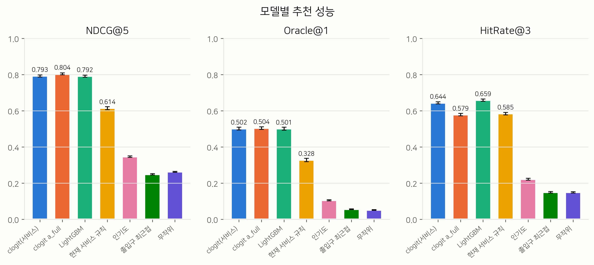
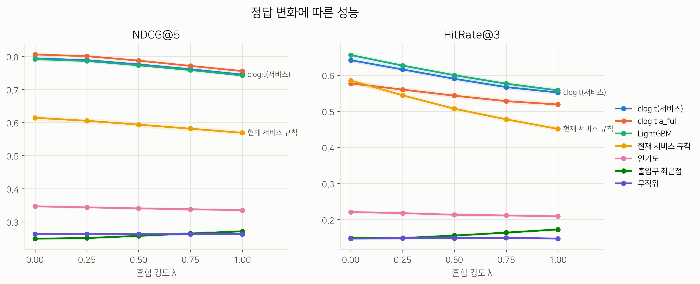
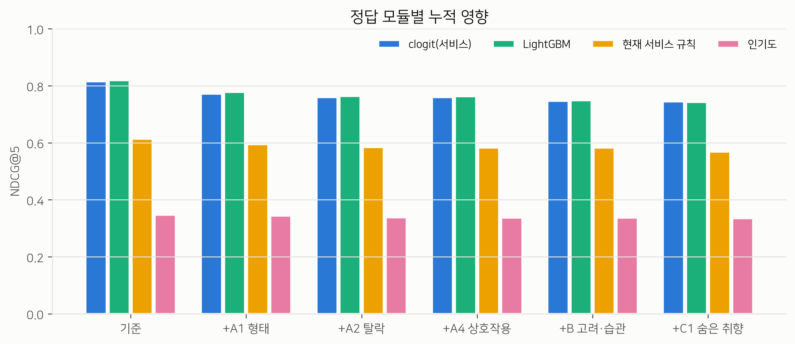
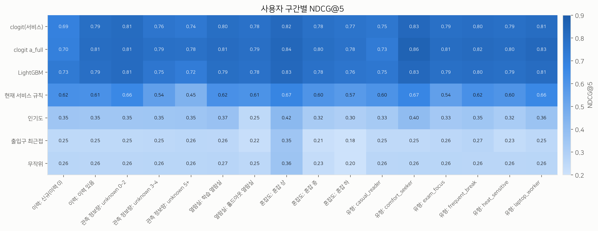
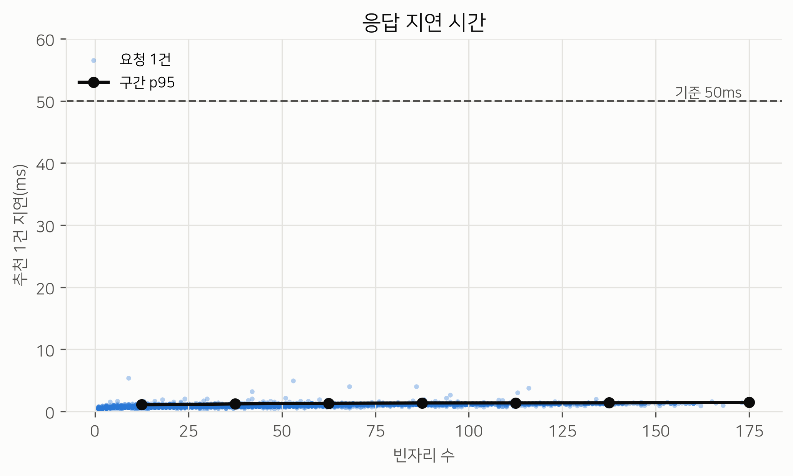

# v1 좌석 추천 모델 테스트 리포트 (유저 테스트 데이터셋 test_v1)

대상: `seat_model/models/v1-20261115` (서비스 모델 `clogit_b_no_exp`). 데이터: 테스트 사용자 92,155건 요청(사용자 2,000명), 세트 11개. 설정: `seat_model/config/model_test.yaml`, 명세: `gunhee/model_test.md`.

## 요약

| 영역 | 판정 | 핵심 수치 |
|---|---|---|
| 1. 정확도 | 통과 | NDCG@5 0.793 vs 서비스 규칙 0.614 · Oracle@1 0.502 vs 0.328 · HitRate@3 0.644 vs 0.585 |
| 2. 일반화 | 통과 | 판정 구간 10개, 최저 이력 신규(이력 0) 0.693(전체 0.793) |
| 3. 사용자 유형 | 통과 | 최저 유형 casual_reader: 0.751 vs 서비스 규칙 0.603 |
| 4. 정답 변화 강건성 | 통과 | real_1.00 NDCG@5 0.745 vs 서비스 규칙 0.569, 역전 세트 0개 |
| 5. 규칙·안정성 | 통과 | 노트북 금지 좌석 노출 0건(노트북 필수 요청 18,537건), 정상 데이터 예외 0건, R 기대 불일치 11건 |
| 6. 일관성 | 통과 | M1 2320/2320 동일, M4 위반 0건(경고: inf_x 음수 2개) |
| 7. 서비스 요건 | 통과 | p50 0.93ms · p95 1.33ms · p99 1.66ms (기준 p95 ≤ 50ms) |

## 1. 모델 비교 (base: 가정이 맞는 세계)

| 모델 | NDCG@5 | Oracle@1 | 참 효용 백분위 | HitRate@1 | HitRate@3 | MRR |
|---|---|---|---|---|---|---|
| clogit(서비스) | 0.793 [0.787, 0.798] | 0.502 [0.494, 0.510] | 0.920 | 0.360 | 0.644 [0.638, 0.650] | 0.533 |
| clogit a_full | 0.804 [0.800, 0.809] | 0.504 [0.497, 0.512] | 0.926 | 0.315 | 0.579 [0.572, 0.585] | 0.484 |
| LightGBM | 0.792 [0.786, 0.797] | 0.501 [0.493, 0.509] | 0.918 | 0.367 | 0.659 [0.653, 0.665] | 0.542 |
| 현재 서비스 규칙 | 0.614 [0.606, 0.623] | 0.328 [0.319, 0.337] | 0.801 | 0.291 | 0.585 [0.577, 0.591] | 0.474 |
| 인기도 | 0.347 [0.342, 0.351] | 0.105 [0.102, 0.108] | 0.585 | 0.087 | 0.222 [0.217, 0.227] | 0.212 |
| 출입구 최근접 | 0.249 [0.245, 0.252] | 0.056 [0.054, 0.059] | 0.481 | 0.055 | 0.150 [0.146, 0.153] | 0.155 |
| 무작위 | 0.263 [0.260, 0.265] | 0.052 [0.050, 0.054] | 0.502 | 0.052 | 0.150 [0.146, 0.153] | 0.156 |

- 서비스 모델은 참 효용 기준에서 현재 서비스 규칙보다 크게 높다(NDCG@5 +0.178, Oracle@1 +0.173). 실제 선택 기준(HitRate@3)의 차이는 +0.059로 더 작다. 노출 목록이 서비스 규칙과 같은 식이라 선택 라벨이 규칙 쪽으로 기울어 있기 때문이다.
- LightGBM은 서비스 모델과 비슷하다(NDCG@5 0.792 vs 0.793). `clogit_a_full`은 노출 특징을 중립(0)으로 두고 점수를 내므로 선택 기준 지표가 낮다.

## 2. 정답 로직 변화에 대한 강건성

| 세트 | λ | clogit(서비스) NDCG@5 | LightGBM | 서비스 규칙 | 인기도 | 서비스 − 규칙 (95% CI) | clogit HitRate@3 | 규칙 HitRate@3 |
|---|---|---|---|---|---|---|---|---|
| `base` | 0.0 | 0.793 | 0.792 | 0.614 | 0.347 | +0.178 [+0.172, +0.184] | 0.644 | 0.585 |
| `base_resim` | 0.0 | 0.794 | 0.792 | 0.614 | 0.347 | +0.179 [+0.174, +0.186] | 0.641 | 0.585 |
| `base_lowtrust` | 0.0 | 0.815 | 0.820 | 0.614 | 0.347 | +0.201 [+0.195, +0.207] | 0.488 | 0.390 |
| `form` | 1.0 | 0.772 | 0.778 | 0.595 | 0.344 | +0.178 [+0.172, +0.183] | 0.498 | 0.404 |
| `c_a2` | 1.0 | 0.759 | 0.764 | 0.584 | 0.338 | +0.175 [+0.169, +0.181] | 0.510 | 0.410 |
| `c_a4` | 1.0 | 0.760 | 0.763 | 0.583 | 0.337 | +0.177 [+0.171, +0.183] | 0.513 | 0.414 |
| `c_b` | 1.0 | 0.747 | 0.749 | 0.583 | 0.337 | +0.164 [+0.159, +0.170] | 0.547 | 0.455 |
| `real_0.25` | 0.25 | 0.789 | 0.786 | 0.605 | 0.344 | +0.183 [+0.178, +0.190] | 0.616 | 0.544 |
| `real_0.50` | 0.5 | 0.776 | 0.773 | 0.594 | 0.340 | +0.182 [+0.177, +0.188] | 0.590 | 0.507 |
| `real_0.75` | 0.75 | 0.761 | 0.759 | 0.581 | 0.338 | +0.180 [+0.174, +0.186] | 0.567 | 0.478 |
| `real_1.00` | 1.0 | 0.745 | 0.743 | 0.569 | 0.335 | +0.176 [+0.170, +0.182] | 0.552 | 0.451 |

- λ가 0 → 1로 가면 서비스 모델 NDCG@5는 0.794 → 0.745(-0.049), LightGBM은 0.792 → 0.743(-0.049), 서비스 규칙은 0.614 → 0.569(-0.045)다. 정답이 우리 가정과 멀어질수록 학습 모델의 우위가 0.179에서 0.176로 바뀐다.
- `base` 대비 `base_lowtrust`는 추천 신뢰도만 낮춘 대조군이다. 정답이 같으므로 두 세트의 차이는 선택 과정 변화의 효과다.

- 서비스 모델 NDCG@5의 단계별 변화: +A1 형태 -0.043, +A2 탈락 -0.013, +A4 상호작용 +0.000, +B 고려·습관 -0.013, +C1 숨은 취향 -0.002.
- 가장 큰 하락은 **+A1 형태** 단계다. 선택 과정 모듈(B)은 정답(효용)을 바꾸지 않으므로 NDCG 변화는 이력 특징을 통해서만 생긴다.

## 3. 구간별 성능 (base)

| 구간 | 요청 | 사용자 | clogit(서비스) NDCG@5 | LightGBM | 서비스 규칙 | clogit HitRate@3 |
|---|---|---|---|---|---|---|
| 이력: 신규(이력 0) | 1,980 | 1,980 | 0.693 | 0.735 | 0.620 | 0.602 |
| 이력: 이력 있음 | 90,175 | 2,000 | 0.795 | 0.793 | 0.614 | 0.645 |
| 관측 정보량: unknown 0–2 | 60,485 | 1,310 | 0.810 | 0.815 | 0.661 | 0.661 |
| 관측 정보량: unknown 3–4 | 25,995 | 566 | 0.761 | 0.753 | 0.542 | 0.623 |
| 관측 정보량: unknown 5+ | 5,675 | 124 | 0.745 | 0.720 | 0.454 | 0.555 |
| 열람실: 학습 열람실 | 73,564 | 1,904 | 0.795 | 0.794 | 0.617 | 0.648 |
| 열람실: 홀드아웃 열람실 | 18,591 | 1,043 | 0.782 | 0.782 | 0.605 | 0.627 |
| 혼잡도: 혼잡 상 | 30,722 | 2,000 | 0.825 | 0.829 | 0.674 | 0.739 |
| 혼잡도: 혼잡 중 | 30,777 | 2,000 | 0.785 | 0.782 | 0.599 | 0.621 |
| 혼잡도: 혼잡 하 | 30,656 | 2,000 | 0.768 | 0.763 | 0.571 | 0.571 |
| 유형: casual_reader | 17,383 | 332 | 0.751 | 0.748 | 0.603 | 0.589 |
| 유형: comfort_seeker | 15,083 | 329 | 0.831 | 0.831 | 0.669 | 0.695 |
| 유형: exam_focus | 15,268 | 338 | 0.789 | 0.786 | 0.543 | 0.624 |
| 유형: frequent_break | 15,894 | 356 | 0.797 | 0.798 | 0.620 | 0.653 |
| 유형: heat_sensitive | 15,563 | 337 | 0.790 | 0.787 | 0.598 | 0.639 |
| 유형: laptop_worker | 12,964 | 308 | 0.806 | 0.808 | 0.661 | 0.676 |

- 가장 낮은 구간은 이력 신규(이력 0)(0.693), 가장 높은 구간은 유형 comfort_seeker(0.831)다. 모든 판정 구간에서 서비스 모델이 서비스 규칙보다 높은지는 요약 표 2번에 있다.

## 4. 서비스 트랙 (SeatRecommender 직접 호출, base)

| 모드 | NDCG@5 | Oracle@1 | HitRate@1 | HitRate@3 | MRR |
|---|---|---|---|---|---|
| 순차(착석마다 observe) | 0.801 | 0.514 | 0.358 | 0.641 | 0.530 |
| 콜드(이력·온라인 갱신 없음) | 0.685 | 0.398 | 0.312 | 0.600 | 0.491 |

순차 모드의 이력 수별 성능

| 이력(착석 수) | 요청 | NDCG@5 | HitRate@3 |
|---|---|---|---|
| 0 | 1,980 | 0.692 | 0.603 |
| 1–4 | 7,924 | 0.742 | 0.606 |
| 5–19 | 29,726 | 0.794 | 0.640 |
| 20+ | 52,525 | 0.818 | 0.649 |

- 순차 모드는 오프라인 clogit(NDCG@5 0.793)에 사용자별 온라인 갱신(μ)이 더해진 실제 서비스 동작이다. 콜드 모드 대비 NDCG@5 +0.116, HitRate@3 +0.042.
- 필수 조건(0.5단계 하드 필터 적용 후): 노트북 필수 요청 18,537건에서 금지 좌석 노출 0건, 조건 만족 좌석이 없어 빈 결과 437건. 실제 선택이 조건 밖 좌석인 요청 437건(관측 오류로 노트북 필수가 붙은 사용자). 이 요청은 하드 필터 때문에 선택 좌석을 맞힐 수 없다.
- 모델 폴더 파일 변경 없음: True

지연 시간(k = 5, 단일 프로세스, 3,000건): p50 0.93ms, p95 1.33ms, p99 1.66ms.

## 5. 일관성·견고성

- **M1 결정성**: 2320/2320 동일(이력 있는 사용자 포함, 같은 상태로 2회 호출).
- **M4 방향성(clogit 계수)**: toiletProximity +2.024, brightness +1.519, airflow +1.576, deskWidth +0.787, outletAvailable +0.915, windowProximity +0.532, viewQuality +0.187 → 위반 0건. 경고: inf_x 음수 brightness -0.0058, deskHeight -0.0227.
- **M4 방향성(LightGBM, 실제 테스트 행)**: match 값과 기여도의 순위상관 toiletProximity +0.79, brightness +0.65, airflow +0.98, deskWidth +0.91, outletAvailable +0.06, windowProximity +0.97, viewQuality +0.93 → 위반 0건.

| 코드 | 입력 | 기대 동작 | 실제 동작 | 기대 일치 |
|---|---|---|---|---|
| R1 | 후보 0개(전 좌석 점유) | 빈 결과 + 사유 | 예외 IndexError: arrays used as indices must be of integer (or boolean) type | **아니오** |
| R2 | 후보 1개 | 그 좌석 반환 | 정상 반환: 추천 1개 | 예 |
| R3 | 후보 500개(학습 최대 176개, 분포 밖) | 정상 동작, 지연 시간 기록 | 정상 반환: 추천 5개 | 예 |
| R4 | 특징 결측(NaN): brightness_by_slot 1석 | 오류 없이 처리, 결측 처리 방식 기록 | 정상 반환: 추천 5개, 점수 NaN/inf 5개 | **아니오** |
| R4 | 특징 결측(NaN): airflow 1석 | 오류 없이 처리, 결측 처리 방식 기록 | 정상 반환: 추천 5개, 점수 NaN/inf 5개 | **아니오** |
| R4 | 특징 결측(NaN): outletAvailable 1석 | 오류 없이 처리, 결측 처리 방식 기록 | 정상 반환: 추천 5개, 점수 NaN/inf 5개 | **아니오** |
| R4 | 특징 결측(NaN): noise_index 1석 | 오류 없이 처리, 결측 처리 방식 기록 | 정상 반환: 추천 5개, 점수 NaN/inf 5개 | **아니오** |
| R4 | 특징 결측(null): airflow 1석 | 오류 없이 처리, 결측 처리 방식 기록 | 정상 반환: 추천 5개, 점수 NaN/inf 5개 | **아니오** |
| R5 | 범위 밖 값: deskWidth = -1.0 | 거부 또는 클리핑 | 정상 반환: 추천 5개 | 예 |
| R5 | 범위 밖 값: deskWidth = 2.0 | 거부 또는 클리핑 | 정상 반환: 추천 5개 | 예 |
| R5 | 범위 밖 값: deskWidth = inf | 거부 또는 클리핑 | 정상 반환: 추천 5개, 점수 NaN/inf 5개 | **아니오** |
| R6 | 중복 좌석 ID | 명시적 오류 | 정상 반환: 추천 5개 | **아니오** |
| R7 | 처음 보는 desk_type(bean_bag) | 오류 없이 처리 | 예외 ValueError: 'bean_bag' is not in list | **아니오** |
| R7 | 처음 보는 날씨(snow) | 오류 없이 처리 | 예외 ValueError: 'snow' is not in list | **아니오** |
| R8 | 관측 프로필 필드 누락: preference_profile 없음 | 기본값 경로 동작 | 정상 반환: 추천 5개 | 예 |
| R8 | 관측 프로필 필드 누락: preferences 항목에 importance 없음 | 기본값 경로 동작 | 예외 KeyError: 'importance' | **아니오** |
| R8 | 관측 프로필 필드 누락: kakaotalk_profile·requirements 없음 | 기본값 경로 동작 | 정상 반환: 추천 5개 | 예 |

기대와 다른 동작은 `seat_model/reports/model_test_bugs.md`에 정리했다(13건).

## 6. 데이터셋 요약

| 세트 | λ | 모듈 | 추천 신뢰도 배율 | 정답 상관 ρ | 정답 1위 일치 | 라벨 반응도 | 평가 요청 |
|---|---|---|---|---|---|---|---|
| `base` | 0.0 | – | 1.00 | 1.000 | 1.000 | +0.000 | 92,155 |
| `base_resim` | 0.0 | – | 1.00 | 1.000 | 1.000 | +0.000 | 92,155 |
| `base_lowtrust` | 0.0 | R | 0.25 | 1.000 | 1.000 | +0.000 | 92,155 |
| `form` | 1.0 | A1, R | 0.25 | 0.908 | 0.675 | +0.020 | 92,155 |
| `c_a2` | 1.0 | A1, A2, R | 0.25 | 0.873 | 0.662 | +0.035 | 92,155 |
| `c_a4` | 1.0 | A1, A2, A4, R | 0.25 | 0.871 | 0.643 | +0.035 | 92,155 |
| `c_b` | 1.0 | A1, A2, A4, B1, B3, R | 0.25 | 0.871 | 0.643 | +0.031 | 92,155 |
| `real_0.25` | 0.25 | A1, A2, A4, B1, B3, C1, R | 0.81 | 0.967 | 0.841 | +0.004 | 92,155 |
| `real_0.50` | 0.5 | A1, A2, A4, B1, B3, C1, R | 0.62 | 0.924 | 0.737 | +0.012 | 92,155 |
| `real_0.75` | 0.75 | A1, A2, A4, B1, B3, C1, R | 0.44 | 0.880 | 0.655 | +0.027 | 92,155 |
| `real_1.00` | 1.0 | A1, A2, A4, B1, B3, C1, R | 0.25 | 0.838 | 0.591 | +0.041 | 92,155 |

## 7. 모델별 강점·약점과 권장

- **clogit(서비스)**: 참 효용·선택 기준 모두 상위권이고, 계수 부호가 해석 가능하며 지연이 짧다(p95 1.3ms). 온라인 갱신으로 착석 기록이 쌓일수록 좋아진다(순차 − 콜드 NDCG@5 +0.116).
- **LightGBM**: 서비스 모델과 성능이 비슷하다(NDCG@5 0.792). 해석·온라인 갱신 경로가 없다.
- **현재 서비스 규칙**: 관측 프로필만 쓰므로 숨은 취향과 이력을 반영하지 못한다.
- **권장**: 현재 서비스 모델(`clogit_b_no_exp` + 온라인 갱신)을 유지한다. 위 강건성 표에서 역전되는 세트가 있으면 그 모듈이 가리키는 취향(예: 탈락 조건, 숨은 취향)을 특징으로 보강하는 것을 검토한다.

## 한계

- 모든 데이터와 정답은 합성이다. 정답 로직(A1~C1, B, R)도 우리가 정한 가정이라, 어느 로직이 실제와 가까운지는 이 테스트로 알 수 없다(사람 라벨 미진행).
- 선택이 확률적이라 `y_chosen` 지표의 세트 간 차이는 작다(라벨 반응도 최대 +0.041). 세트 비교는 참 효용 기준 지표로 읽는다.
- `service_rule`은 생성기의 노출 정책과 같은 식이라 `y_chosen` 지표에서 유리하다.
- 배포 환경(synth-1.1 + 칸막이 수정)과 설문 형식 입력의 서비스 조건 테스트셋(T2)은 아직 없다. 이 결과는 모델이 학습한 환경 기준이다.
- XGBoost(저장된 모델 없음)와 신경망(미학습)은 평가하지 않았다. 테스트 결과로 모델을 다시 학습하거나 튜닝하지 않았다.
